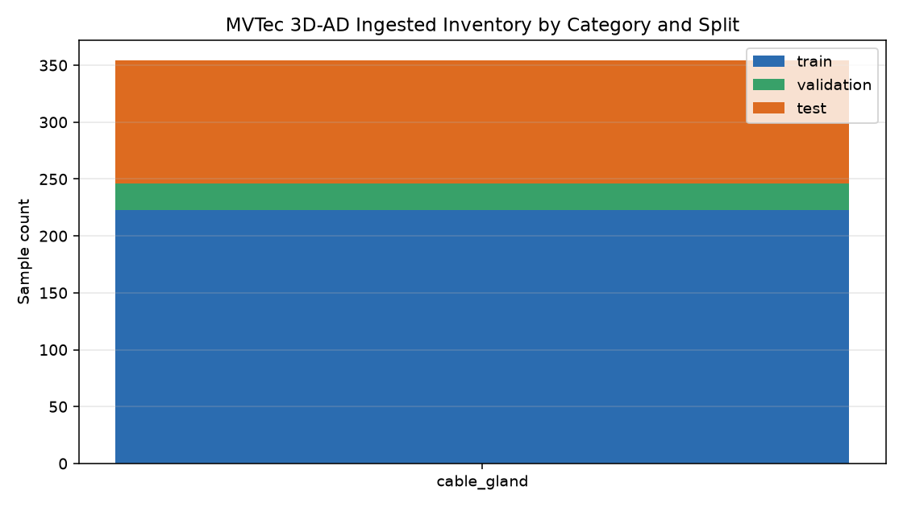
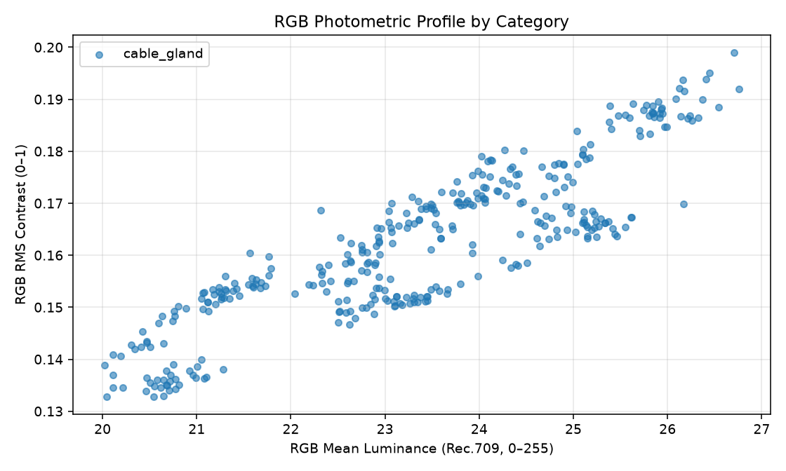

# VISTA — Exploratory Data Analysis Report (MVTec 3D-AD)

- **Generated (UTC):** `2026-11-20T00:24:08.497040+00:00`
- **Dataset:** `mvtec_3d_ad` version `1.0.0` (`CC BY-NC-SA 4.0 (Non-Commercial Academic/Research Use Only)`)
- **Preprocessing Version:** `silver_v1` (config hash `172131d30e11d64f`)
- **Ingested Categories Covered:** `cable_gland`
- **Total Indexed Samples:** `354`
- **Training Mart Test-Leakage Check (`mart_training_ready_samples` where `split='test'`):** `0` rows

> **Methodological Caveat:** MVTec 3D-AD is a curated academic benchmark. Defect proportions in the `test` split reflect benchmark design choices and **must not** be interpreted as real industrial factory defect rates. Test labels are strictly isolated from `mart_training_ready_samples` and `training_ready_samples.parquet`.

---

## 1. Dataset Inventory & Split Coverage (Q1)

### Inventory by Category and Split

Source SQL: `analytics/sql/01_dataset_inventory.sql`

| category_name | material_type | split | sample_count | passed_count | warned_count | quarantined_count | failed_count | pass_pct | raw_size_mb | silver_ready_count | reliable_normal_count |
| --- | --- | --- | --- | --- | --- | --- | --- | --- | --- | --- | --- |
| cable_gland | manufactured | test | 108 | 88 | 20 | 0 | 0 | 81.4800 | 219.9100 | 108 | 108 |
| cable_gland | manufactured | train | 223 | 151 | 72 | 0 | 0 | 67.7100 | 456.8800 | 223 | 223 |
| cable_gland | manufactured | validation | 23 | 14 | 9 | 0 | 0 | 60.8700 | 47.1100 | 23 | 23 |

## 2. RGB Photometric & Texture Quality (Q4)

### RGB Quality Summary by Category and Split

Source SQL: `analytics/sql/03_rgb_quality.sql`

| category_name | material_type | split | sample_count | mean_brightness | median_brightness | std_brightness | mean_contrast_rms | mean_contrast_p5_p95 | mean_laplacian_var | median_laplacian_var | mean_saturation | mean_underexposed_pct | mean_overexposed_pct |
| --- | --- | --- | --- | --- | --- | --- | --- | --- | --- | --- | --- | --- | --- |
| cable_gland | manufactured | test | 108 | 21.4600 | 21.1200 | 1.1400 | 0.1492 | 122.7000 | 52.7400 | 50.7000 | 0.2716 | 83.9400 | 0.0100 |
| cable_gland | manufactured | train | 223 | 24.1900 | 24.0500 | 1.2300 | 0.1680 | 138.1200 | 72.6200 | 66.2800 | 0.2754 | 83.6500 | 0.0300 |
| cable_gland | manufactured | validation | 23 | 24.3600 | 24.3400 | 0.5900 | 0.1687 | 137.9400 | 65.0600 | 62.5300 | 0.2767 | 83.4900 | 0.0400 |

## 3. 3D Geometric Validity & Missingness (Q3)

### 3D Geometric Quality by Category

Source SQL: `analytics/sql/04_geometry_quality.sql`

| category_name | material_type | preprocessing_version | sample_count | mean_valid_3d_pct | mean_missing_3d_pct | median_missing_3d_pct | max_missing_3d_pct | mean_z_meters | mean_z_std_meters | geometry_outlier_count |
| --- | --- | --- | --- | --- | --- | --- | --- | --- | --- | --- |
| cable_gland | manufactured | silver_v1 | 354 | 60.9700 | 39.0300 | 38.8100 | 46.2200 | 0.6560 | 0.0173 | 21 |

## 4. Cross-Modal Association: RGB Indicators vs 3D Missingness (Q5)

### SQL Cross-Modal Correlation Summary

Source SQL: `analytics/sql/05_cross_modal_quality.sql`

| category_name | sample_count | corr_brightness_vs_missing3d | corr_contrast_vs_missing3d | corr_sharpness_vs_missing3d | corr_saturation_vs_missing3d | corr_underexp_vs_missing3d | corr_overexp_vs_missing3d |
| --- | --- | --- | --- | --- | --- | --- | --- |
| cable_gland | 354 | -0.9392 | -0.7155 | -0.5713 | -0.3017 | 0.2767 | -0.1596 |

### Descriptive Observations vs Statistical Conclusions

- **Descriptive observations** summarize sample counts, medians, IQRs, and visual scatter patterns in the currently ingested categories (`cable_gland`).
- **Statistical rank-correlation checks (Spearman $\rho$, two-sided $p$-value):**
- **cable_gland** ($n=354$): Spearman(brightness, missing_3d) = `-0.9032` ($p=2.395e-131$); Spearman(laplacian_var, missing_3d) = `-0.5017` ($p=5.751e-24$).
- **Caution:** Association within a single camera/lighting bench does not prove causal degradation; background area ratio and object footprint simultaneously influence both global RGB statistics and structured-light 3D coverage.

## 5. Unusual Depth & Point-Cloud Outliers (Q6)

### Flagged Geometry & Depth Outliers

Source SQL: `analytics/sql/08_depth_pointcloud_outliers.sql`

| category_name | split | defect_type | sample_key | missing_3d_ratio | missing_robust_z | z_mean_m | z_mean_robust_z | z_std_m | bbox_vol_m3 | geometry_outlier_flag | rgb_quality_outlier_flag |
| --- | --- | --- | --- | --- | --- | --- | --- | --- | --- | --- | --- |
| cable_gland | test | good | 1.0.0:cable_gland:test:good:001 | 0.3659 | -12.2830 | 0.6563 | 3.0550 | 0.0167 | 0.0006 | True | False |
| cable_gland | test | good | 1.0.0:cable_gland:test:good:000 | 0.3660 | -12.2690 | 0.6564 | 3.3400 | 0.0179 | 0.0007 | True | False |
| cable_gland | test | good | 1.0.0:cable_gland:test:good:008 | 0.3775 | -10.5630 | 0.6562 | 2.9370 | 0.0169 | 0.0006 | True | False |
| cable_gland | test | good | 1.0.0:cable_gland:test:good:014 | 0.3779 | -10.5130 | 0.6562 | 2.9510 | 0.0169 | 0.0007 | True | False |
| cable_gland | test | good | 1.0.0:cable_gland:test:good:016 | 0.3787 | -10.3940 | 0.6563 | 3.0130 | 0.0171 | 0.0007 | True | False |
| cable_gland | test | good | 1.0.0:cable_gland:test:good:004 | 0.3794 | -10.2910 | 0.6563 | 3.0880 | 0.0167 | 0.0006 | True | False |
| cable_gland | test | good | 1.0.0:cable_gland:test:good:012 | 0.3800 | -10.2030 | 0.6562 | 2.7600 | 0.0172 | 0.0007 | True | False |
| cable_gland | test | good | 1.0.0:cable_gland:test:good:007 | 0.3804 | -10.1370 | 0.6563 | 3.0130 | 0.0170 | 0.0006 | True | False |
| cable_gland | test | good | 1.0.0:cable_gland:test:good:017 | 0.3810 | -10.0540 | 0.6563 | 2.9620 | 0.0174 | 0.0007 | True | False |
| cable_gland | test | good | 1.0.0:cable_gland:test:good:009 | 0.3815 | -9.9770 | 0.6559 | 2.0430 | 0.0171 | 0.0006 | True | False |
| cable_gland | test | good | 1.0.0:cable_gland:test:good:013 | 0.3833 | -9.7160 | 0.6560 | 2.1850 | 0.0169 | 0.0006 | True | False |
| cable_gland | test | good | 1.0.0:cable_gland:test:good:015 | 0.3841 | -9.5920 | 0.6559 | 1.9240 | 0.0173 | 0.0006 | True | False |
| cable_gland | test | good | 1.0.0:cable_gland:test:good:005 | 0.3843 | -9.5670 | 0.6560 | 2.1790 | 0.0174 | 0.0006 | True | False |
| cable_gland | test | good | 1.0.0:cable_gland:test:good:010 | 0.3846 | -9.5140 | 0.6563 | 3.0420 | 0.0170 | 0.0006 | True | False |
| cable_gland | test | good | 1.0.0:cable_gland:test:good:019 | 0.3863 | -9.2650 | 0.6565 | 3.6320 | 0.0171 | 0.0007 | True | False |
| cable_gland | test | good | 1.0.0:cable_gland:test:good:006 | 0.3865 | -9.2380 | 0.6558 | 1.7480 | 0.0171 | 0.0006 | True | False |
| cable_gland | test | good | 1.0.0:cable_gland:test:good:003 | 0.3868 | -9.1980 | 0.6560 | 2.3010 | 0.0176 | 0.0006 | True | False |
| cable_gland | test | good | 1.0.0:cable_gland:test:good:020 | 0.3890 | -8.8670 | 0.6562 | 2.8190 | 0.0173 | 0.0006 | True | False |
| cable_gland | test | good | 1.0.0:cable_gland:test:good:011 | 0.3895 | -8.7890 | 0.6565 | 3.8030 | 0.0173 | 0.0007 | True | False |
| cable_gland | test | good | 1.0.0:cable_gland:test:good:018 | 0.3912 | -8.5430 | 0.6563 | 3.1320 | 0.0175 | 0.0006 | True | False |
| cable_gland | test | good | 1.0.0:cable_gland:test:good:002 | 0.3936 | -8.1890 | 0.6562 | 2.8500 | 0.0169 | 0.0006 | True | False |

## 6. Benchmark Test Defect Distributions (Q7)

### Defect-Type Distribution in Labeled Benchmark Test Data

Source SQL: `analytics/sql/06_defect_distribution.sql`

| category_name | defect_type | is_anomalous_benchmark | sample_count | category_test_total | benchmark_test_share_pct |
| --- | --- | --- | --- | --- | --- |
| cable_gland | cut | True | 22 | 108 | 20.3700 |
| cable_gland | hole | True | 22 | 108 | 20.3700 |
| cable_gland | thread | True | 22 | 108 | 20.3700 |
| cable_gland | bent | True | 21 | 108 | 19.4400 |
| cable_gland | good | False | 21 | 108 | 19.4400 |

## 7. Defect Types vs Measured Geometry & Texture (Q8)

### Defect Type vs RGB & 3D Characteristics

Source SQL: `analytics/sql/09_defect_geometry_texture.sql`

| category_name | defect_type | is_anomalous_benchmark | sample_count | mean_brightness | mean_laplacian_var | mean_missing_3d_pct | mean_z_m | mean_z_std_m |
| --- | --- | --- | --- | --- | --- | --- | --- | --- |
| cable_gland | good | False | 21 | 23.5400 | 66.8200 | 38.2300 | 0.6562 | 0.0172 |
| cable_gland | bent | True | 21 | 21.0500 | 53.7200 | 45.1800 | 0.6550 | 0.0176 |
| cable_gland | cut | True | 22 | 20.8700 | 47.2900 | 45.2000 | 0.6553 | 0.0174 |
| cable_gland | hole | True | 22 | 20.8300 | 46.9100 | 44.8300 | 0.6552 | 0.0175 |
| cable_gland | thread | True | 22 | 21.1000 | 49.6600 | 45.0900 | 0.6552 | 0.0175 |

## 8. Pipeline Stage Execution Performance (Q9)

### Stage Runtime & Throughput

Source SQL: `analytics/sql/07_pipeline_performance.sql`

| stage_name | execution_count | succeeded_runs | failed_runs | total_duration_s | avg_duration_s | max_duration_s | total_items_processed | avg_items_per_sec |
| --- | --- | --- | --- | --- | --- | --- | --- | --- |
| ingest | 5 | 4 | 1 | 568.4200 | 113.6840 | 490.1570 | 1416 | 18.2300 |
| publish_gold | 7 | 0 | 5 | 518.5360 | 74.0770 | 351.4420 | 0 | — |
| transform | 5 | 3 | 1 | 501.2290 | 100.2460 | 238.7480 | 1062 | 4.0700 |
| validate | 4 | 4 | 0 | 239.5580 | 59.8900 | 75.9680 | 1416 | 6.0500 |
| discover | 7 | 4 | 3 | 82.3510 | 11.7640 | 18.1140 | 4 | 0.2100 |
| quality_metrics | 3 | 3 | 0 | 47.9840 | 15.9950 | 16.2660 | 1062 | 22.1400 |

## 9. Quality Distributions Across Preprocessing Versions (Q10)

### Version-to-Version Quality Comparison

Source SQL: `analytics/sql/10_version_quality_comparison.sql`

| dataset_version | preprocessing_version | config_hash | category_name | sample_count | mean_brightness | mean_sharpness | mean_valid_3d_pct | mean_missing_3d_pct | mean_z_m | geometry_outliers |
| --- | --- | --- | --- | --- | --- | --- | --- | --- | --- | --- |
| 1.0.0 | silver_v1 | 172131d30e11d64f | cable_gland | 354 | 23.3700 | 66.0600 | 60.9700 | 39.0300 | 0.6560 | 21 |

---

## Limitations

1. Only the explicitly authorized subset of categories (`cable_gland`) has been ingested to respect local disk space and avoid downloading the full 13.2 GB archive without approval. Findings must not be extrapolated to un-ingested MVTec 3D-AD categories (especially organic categories like `bagel`, `carrot`, `peach`, `potato`).
2. Global RGB sharpness (`Laplacian variance`) and luminance mix foreground object pixels with dark/uniform conveyor/table background pixels.
3. Structured-light missingness (`z == 0`) combines physical background outside sensor frustum with specular/occluded object regions.
