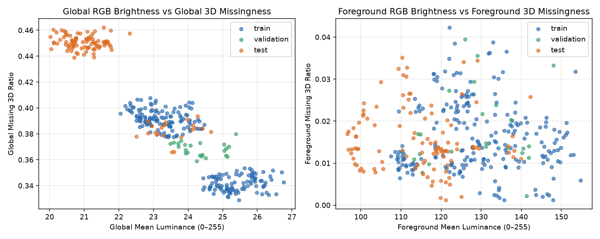
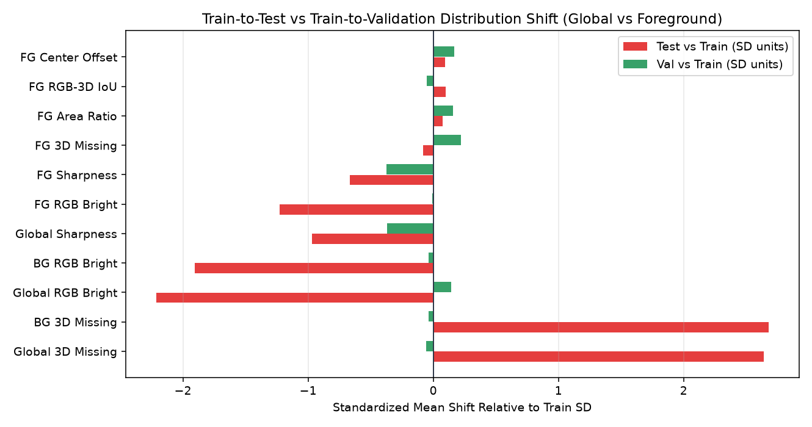

# VISTA — Exploratory Data Analysis Report (MVTec 3D-AD)

- **Generated (UTC):** `2026-11-20T10:28:11.920290+00:00`
- **Immutable Gold Snapshot ID:** `snap_1_0_0_silver_v1_172131d3_907737715593`
- **Snapshot Manifest SHA-256:** `e7922b010b8788a8a33b351a17541dca9a1d05dc744d237894bc3fc8b711c97b`
- **Telemetry Cutoff (UTC):** `2026-11-20T10:27:50.491166+00:00`
- **Dataset:** `mvtec_3d_ad` version `1.0.0` (`CC BY-NC-SA 4.0 (Non-Commercial Academic/Research Use Only)`)
- **Preprocessing Version:** `silver_v1` (config hash `172131d30e11d64f`)
- **Ingested Categories Covered:** `cable_gland`
- **Total Indexed Samples:** `354`
- **Training Mart Test-Leakage Check (`mart_training_ready_samples` where `split='test'`):** `0` rows
- **Training Mart Partitions:** `train=223, validation=23`

> **Methodological Safeguards:**
> 1. MVTec 3D-AD is a curated academic benchmark; `test` defect proportions reflect benchmark design and **must not** be interpreted as real industrial factory defect rates.
> 2. All ML-facing normalization parameters (`normalization_artifacts`) are fitted **exclusively on eligible `train` samples** and applied frozen to `validation` and `test`.
> 3. Foreground masks (`fg_otsu_plane_v1`) are strictly unsupervised (RGB Otsu contrast + 3D border support-plane residual); benchmark ground-truth defect masks are **never** used to compute quality features.
> 4. Associations below are strictly descriptive/statistical observations, not causal proofs.

---

## 1. Dataset Inventory & Split Coverage (Q1)

### Inventory by Category and Split

Source SQL: `analytics/sql/01_dataset_inventory.sql`

| category_name | material_type | split | sample_count | passed_count | warned_count | quarantined_count | failed_count | pass_pct | raw_size_mb | silver_ready_count | reliable_normal_count |
| --- | --- | --- | --- | --- | --- | --- | --- | --- | --- | --- | --- |
| cable_gland | manufactured | test | 108 | 88 | 20 | 0 | 0 | 81.4800 | 219.9100 | 108 | 108 |
| cable_gland | manufactured | train | 223 | 151 | 72 | 0 | 0 | 67.7100 | 456.8800 | 223 | 223 |
| cable_gland | manufactured | validation | 23 | 14 | 9 | 0 | 0 | 60.8700 | 47.1100 | 23 | 23 |

## 2. Global vs Foreground-Aware Quality Decomposition (P1 Q1 & Q4)

### Global vs Foreground vs Background Quality Metrics

Source SQL: `analytics/sql/11_foreground_vs_global_quality.sql`

| category_name | material_type | split | sample_count | global_rgb_brightness | fg_rgb_brightness | bg_rgb_brightness | global_sharpness_lap | fg_sharpness_lap | global_missing_3d_pct | fg_missing_3d_pct | bg_missing_3d_pct | global_minus_fg_missing_pp | fg_area_pct | mean_fg_rgb_3d_iou | mean_fg_center_offset |
| --- | --- | --- | --- | --- | --- | --- | --- | --- | --- | --- | --- | --- | --- | --- | --- |
| cable_gland | manufactured | test | 108 | 21.4600 | 114.5600 | 7.4700 | 52.7400 | 244.8000 | 43.7400 | 1.5500 | 50.1400 | 42.1900 | 13.1600 | 0.8459 | 0.0478 |
| cable_gland | manufactured | train | 223 | 24.1900 | 129.2800 | 8.5000 | 72.6200 | 330.2000 | 36.9800 | 1.6200 | 42.3000 | 35.3600 | 13.0700 | 0.8416 | 0.0453 |
| cable_gland | manufactured | validation | 23 | 24.3600 | 129.1800 | 8.4800 | 65.0600 | 282.2800 | 36.8300 | 1.8000 | 42.1800 | 35.0300 | 13.2500 | 0.8393 | 0.0498 |

### Global RGB Photometric Summary by Category and Split

Source SQL: `analytics/sql/03_rgb_quality.sql`

| category_name | material_type | split | sample_count | mean_brightness | median_brightness | std_brightness | mean_contrast_rms | mean_contrast_p5_p95 | mean_laplacian_var | median_laplacian_var | mean_saturation | mean_underexposed_pct | mean_overexposed_pct |
| --- | --- | --- | --- | --- | --- | --- | --- | --- | --- | --- | --- | --- | --- |
| cable_gland | manufactured | test | 108 | 21.4600 | 21.1200 | 1.1400 | 0.1492 | 122.7000 | 52.7400 | 50.7000 | 0.2716 | 83.9400 | 0.0100 |
| cable_gland | manufactured | train | 223 | 24.1900 | 24.0500 | 1.2300 | 0.1680 | 138.1200 | 72.6200 | 66.2800 | 0.2754 | 83.6500 | 0.0300 |
| cable_gland | manufactured | validation | 23 | 24.3600 | 24.3400 | 0.5900 | 0.1687 | 137.9400 | 65.0600 | 62.5300 | 0.2767 | 83.4900 | 0.0400 |

### 3D Geometric Quality by Category

Source SQL: `analytics/sql/04_geometry_quality.sql`

| category_name | material_type | preprocessing_version | sample_count | mean_valid_3d_pct | mean_missing_3d_pct | median_missing_3d_pct | max_missing_3d_pct | mean_z_meters | mean_z_std_meters | geometry_outlier_count |
| --- | --- | --- | --- | --- | --- | --- | --- | --- | --- | --- |
| cable_gland | manufactured | silver_v1 | 354 | 60.9700 | 39.0300 | 38.8100 | 46.2200 | 0.6560 | 0.0173 | 21 |

## 3. Cross-Modal Association: Global vs Background-Adjusted Foreground (Q5 & P1 Q2)

### Global Cross-Modal Pearson Correlations (SQL)

Source SQL: `analytics/sql/05_cross_modal_quality.sql`

| category_name | sample_count | corr_brightness_vs_missing3d | corr_contrast_vs_missing3d | corr_sharpness_vs_missing3d | corr_saturation_vs_missing3d | corr_underexp_vs_missing3d | corr_overexp_vs_missing3d |
| --- | --- | --- | --- | --- | --- | --- | --- |
| cable_gland | 354 | -0.9392 | -0.7155 | -0.5713 | -0.3017 | 0.2767 | -0.1596 |

### Foreground vs Global Cross-Modal Correlations (SQL)

Source SQL: `analytics/sql/12_cross_modal_bg_adjusted.sql`

| category_name | sample_count | global_corr_bright_vs_miss3d | fg_corr_bright_vs_miss3d | global_corr_sharp_vs_miss3d | fg_corr_sharp_vs_miss3d | bg_corr_bright_vs_miss3d | corr_footprint_vs_global_miss3d | corr_footprint_vs_fg_miss3d |
| --- | --- | --- | --- | --- | --- | --- | --- | --- |
| cable_gland | 354 | -0.9392 | -0.0266 | -0.5713 | 0.1607 | -0.9091 | -0.0427 | -0.0851 |

### Statistical Correlation Analysis (Spearman, Pearson, 95% Bootstrap CIs, and Partial Spearman)

Partial Spearman controls simultaneously for object footprint (`fg_area_ratio`) and dark-table background 3D dropout (`bg_missing_3d_ratio`):

| category | metric_pair | n | spearman_95ci | spearman_p | pearson_95ci | partial_spearman_bg_adj |
| --- | --- | --- | --- | --- | --- | --- |
| cable_gland | Global brightness vs Global 3D missing | 354 | -0.9032 [-0.9158, -0.8837] | 2.4e-131 | -0.9392 [-0.9481, -0.9306] | -0.5782 (p=5.76e-33) |
| cable_gland | Global sharpness vs Global 3D missing | 354 | -0.5017 [-0.5750, -0.4168] | 5.75e-24 | -0.5713 [-0.6283, -0.5100] | -0.0434 (p=0.416) |
| cable_gland | Foreground brightness vs Foreground 3D missing | 354 | 0.0270 [-0.0709, 0.1264] | 0.613 | -0.0266 [-0.1148, 0.0603] | -0.0383 (p=0.473) |
| cable_gland | Foreground sharpness vs Foreground 3D missing | 354 | 0.2508 [0.1483, 0.3442] | 1.77e-06 | 0.1607 [0.0677, 0.2500] | 0.2979 (p=1.1e-08) |

## 4. Train-to-Test Distribution Shift & Framing / Footprint Effects (P1 Q3 & Q5)

### Train vs Validation vs Test Standardized Shifts (SQL)

Source SQL: `analytics/sql/13_train_test_distribution_shift.sql`

| category_name | split | feature_name | modality_group | sample_count | train_mean | split_mean | train_median | split_median | shift_in_train_sd |
| --- | --- | --- | --- | --- | --- | --- | --- | --- | --- |
| cable_gland | test | bg_missing_3d_ratio | 3d_background | 108 | 0.4230 | 0.5014 | 0.4394 | 0.5149 | 2.6726 |
| cable_gland | test | global_missing_3d_ratio | 3d_global | 108 | 0.3698 | 0.4374 | 0.3826 | 0.4489 | 2.6344 |
| cable_gland | test | global_rgb_brightness_mean | rgb_global | 108 | 24.1885 | 21.4636 | 24.0465 | 21.1207 | -2.2085 |
| cable_gland | test | bg_rgb_brightness_mean | rgb_background | 108 | 8.5014 | 7.4732 | 8.4978 | 7.3572 | -1.9027 |
| cable_gland | test | fg_rgb_brightness_mean | rgb_foreground | 108 | 129.2842 | 114.5567 | 127.8553 | 115.9762 | -1.2249 |
| cable_gland | test | fg_rgb_laplacian_var | rgb_foreground | 108 | 330.1957 | 244.8035 | 313.5132 | 248.9153 | -0.6632 |
| cable_gland | test | fg_rgb_3d_iou | cross_modal | 108 | 0.8416 | 0.8459 | 0.8467 | 0.8481 | 0.0973 |
| cable_gland | test | fg_center_offset_norm | framing | 108 | 0.0453 | 0.0478 | 0.0393 | 0.0421 | 0.0921 |
| cable_gland | test | fg_missing_3d_ratio | 3d_foreground | 108 | 0.0162 | 0.0155 | 0.0141 | 0.0135 | -0.0827 |
| cable_gland | test | fg_area_ratio | framing | 108 | 0.1307 | 0.1316 | 0.1269 | 0.1266 | 0.0768 |
| cable_gland | validation | fg_rgb_laplacian_var | rgb_foreground | 23 | 330.1957 | 282.2823 | 313.5132 | 274.2978 | -0.3721 |
| cable_gland | validation | fg_missing_3d_ratio | 3d_foreground | 23 | 0.0162 | 0.0180 | 0.0141 | 0.0141 | 0.2212 |
| cable_gland | validation | fg_center_offset_norm | framing | 23 | 0.0453 | 0.0498 | 0.0393 | 0.0370 | 0.1678 |
| cable_gland | validation | fg_area_ratio | framing | 23 | 0.1307 | 0.1325 | 0.1269 | 0.1270 | 0.1579 |
| cable_gland | validation | global_rgb_brightness_mean | rgb_global | 23 | 24.1885 | 24.3619 | 24.0465 | 24.3361 | 0.1406 |
| cable_gland | validation | global_missing_3d_ratio | 3d_global | 23 | 0.3698 | 0.3683 | 0.3826 | 0.3687 | -0.0576 |
| cable_gland | validation | fg_rgb_3d_iou | cross_modal | 23 | 0.8416 | 0.8393 | 0.8467 | 0.8397 | -0.0530 |
| cable_gland | validation | bg_missing_3d_ratio | 3d_background | 23 | 0.4230 | 0.4218 | 0.4394 | 0.4225 | -0.0387 |
| cable_gland | validation | bg_rgb_brightness_mean | rgb_background | 23 | 8.5014 | 8.4818 | 8.4978 | 8.4869 | -0.0363 |
| cable_gland | validation | fg_rgb_brightness_mean | rgb_foreground | 23 | 129.2842 | 129.1806 | 127.8553 | 130.2410 | -0.0086 |

### Two-Sample KS Tests & Retrospective Benchmark Group Decomposition

Note: The `test/good` vs `test/anomalous` columns below are strictly retrospective benchmark diagnostics to expose potential acquisition shortcuts, never model inputs.

| category | feature | train_mean | test_mean | test_shift_sd | test_good_shift_sd | test_anom_shift_sd | ks_stat | ks_p |
| --- | --- | --- | --- | --- | --- | --- | --- | --- |
| cable_gland | global_missing_3d_ratio | 0.3698 | 0.4374 | 2.6404 | 0.4878 | 3.1600 | 0.8056 | 2.4e-48 |
| cable_gland | bg_missing_3d_ratio | 0.4230 | 0.5014 | 2.6786 | 0.4824 | 3.2087 | 0.8056 | 2.4e-48 |
| cable_gland | fg_missing_3d_ratio | 0.0162 | 0.0155 | -0.0829 | 0.1152 | -0.1307 | 0.0980 | 0.45 |
| cable_gland | global_rgb_brightness_mean | 24.1885 | 21.4636 | -2.2134 | -0.5284 | -2.6201 | 0.7963 | 5.43e-47 |
| cable_gland | bg_rgb_brightness_mean | 8.5014 | 7.4732 | -1.9070 | -0.5102 | -2.2441 | 0.7517 | 3.81e-41 |
| cable_gland | fg_rgb_brightness_mean | 129.2842 | 114.5567 | -1.2276 | -0.2426 | -1.4654 | 0.5553 | 2.89e-21 |
| cable_gland | fg_rgb_laplacian_var | 330.1957 | 244.8035 | -0.6647 | -0.1534 | -0.7881 | 0.3451 | 3.2e-08 |
| cable_gland | fg_area_ratio | 0.1307 | 0.1316 | 0.0769 | -0.0243 | 0.1014 | 0.0748 | 0.774 |
| cable_gland | fg_rgb_3d_iou | 0.8416 | 0.8459 | 0.0976 | 0.0284 | 0.1143 | 0.1298 | 0.154 |
| cable_gland | fg_center_offset_norm | 0.0453 | 0.0478 | 0.0924 | -0.2799 | 0.1822 | 0.0960 | 0.477 |

## 5. Extreme Geometric Missingness & Outlier Diagnostics (Q6 & P1 Q4)

### Extreme Global vs Foreground 3D Missingness

Source SQL: `analytics/sql/14_extreme_geometric_missingness.sql`

| category_name | split | defect_type | sample_key | global_missing_3d_pct | fg_missing_3d_pct | bg_missing_3d_pct | fg_area_pct | fg_rgb_3d_iou | train_ref_geometry_outlier_flag |
| --- | --- | --- | --- | --- | --- | --- | --- | --- | --- |
| cable_gland | train | good | 1.0.0:cable_gland:train:good:199 | 40.1700 | 4.2300 | 45.2100 | 12.2900 | 0.8219 | True |
| cable_gland | validation | good | 1.0.0:cable_gland:validation:good:004 | 37.2300 | 3.9400 | 42.0700 | 12.7000 | 0.8205 | False |
| cable_gland | train | good | 1.0.0:cable_gland:train:good:006 | 34.0200 | 3.8800 | 38.5800 | 13.1200 | 0.8559 | False |
| cable_gland | train | good | 1.0.0:cable_gland:train:good:133 | 39.1100 | 3.8500 | 44.2400 | 12.7000 | 0.8404 | False |
| cable_gland | train | good | 1.0.0:cable_gland:train:good:094 | 34.8300 | 3.6500 | 39.2800 | 12.4900 | 0.8210 | False |
| cable_gland | train | good | 1.0.0:cable_gland:train:good:080 | 34.6600 | 3.6300 | 39.1400 | 12.6300 | 0.8117 | False |
| cable_gland | train | good | 1.0.0:cable_gland:train:good:003 | 33.9000 | 3.6100 | 38.3800 | 12.8800 | 0.8583 | False |
| cable_gland | validation | good | 1.0.0:cable_gland:validation:good:019 | 37.0000 | 3.5500 | 41.7900 | 12.5100 | 0.8087 | False |
| cable_gland | test | hole | 1.0.0:cable_gland:test:hole:009 | 45.2700 | 3.5200 | 51.3900 | 12.7800 | 0.8656 | False |
| cable_gland | train | good | 1.0.0:cable_gland:train:good:175 | 40.0500 | 3.4900 | 45.2600 | 12.4900 | 0.8121 | False |
| cable_gland | test | good | 1.0.0:cable_gland:test:good:000 | 36.6000 | 3.4400 | 41.2600 | 12.3200 | 0.8125 | False |
| cable_gland | test | good | 1.0.0:cable_gland:test:good:011 | 38.9500 | 3.4100 | 43.9700 | 12.3600 | 0.8335 | False |
| cable_gland | validation | good | 1.0.0:cable_gland:validation:good:013 | 37.9900 | 3.3200 | 42.7000 | 11.9600 | 0.8020 | False |
| cable_gland | test | thread | 1.0.0:cable_gland:test:thread:018 | 45.4800 | 3.2700 | 51.5300 | 12.5300 | 0.8348 | False |
| cable_gland | test | thread | 1.0.0:cable_gland:test:thread:009 | 45.5000 | 3.2500 | 51.5200 | 12.4600 | 0.8425 | False |
| cable_gland | train | good | 1.0.0:cable_gland:train:good:191 | 39.9200 | 3.1800 | 45.1700 | 12.5100 | 0.8347 | False |
| cable_gland | train | good | 1.0.0:cable_gland:train:good:056 | 35.0300 | 3.1800 | 39.4500 | 12.1800 | 0.8076 | False |
| cable_gland | train | good | 1.0.0:cable_gland:train:good:087 | 34.7100 | 3.1700 | 39.1500 | 12.3300 | 0.8263 | False |
| cable_gland | train | good | 1.0.0:cable_gland:train:good:137 | 38.8100 | 3.1500 | 43.9200 | 12.5400 | 0.8292 | False |
| cable_gland | train | good | 1.0.0:cable_gland:train:good:171 | 39.9000 | 3.1400 | 45.0800 | 12.3500 | 0.8290 | False |

### Descriptive EDA Depth & Point-Cloud Outliers

Source SQL: `analytics/sql/08_depth_pointcloud_outliers.sql`

| category_name | split | defect_type | sample_key | missing_3d_ratio | missing_robust_z | z_mean_m | z_mean_robust_z | z_std_m | bbox_vol_m3 | geometry_outlier_flag | rgb_quality_outlier_flag |
| --- | --- | --- | --- | --- | --- | --- | --- | --- | --- | --- | --- |
| cable_gland | test | good | 1.0.0:cable_gland:test:good:001 | 0.3659 | -12.2830 | 0.6563 | 3.0550 | 0.0167 | 0.0006 | True | False |
| cable_gland | test | good | 1.0.0:cable_gland:test:good:000 | 0.3660 | -12.2690 | 0.6564 | 3.3400 | 0.0179 | 0.0007 | True | False |
| cable_gland | test | good | 1.0.0:cable_gland:test:good:008 | 0.3775 | -10.5630 | 0.6562 | 2.9370 | 0.0169 | 0.0006 | True | False |
| cable_gland | test | good | 1.0.0:cable_gland:test:good:014 | 0.3779 | -10.5130 | 0.6562 | 2.9510 | 0.0169 | 0.0007 | True | False |
| cable_gland | test | good | 1.0.0:cable_gland:test:good:016 | 0.3787 | -10.3940 | 0.6563 | 3.0130 | 0.0171 | 0.0007 | True | False |
| cable_gland | test | good | 1.0.0:cable_gland:test:good:004 | 0.3794 | -10.2910 | 0.6563 | 3.0880 | 0.0167 | 0.0006 | True | False |
| cable_gland | test | good | 1.0.0:cable_gland:test:good:012 | 0.3800 | -10.2030 | 0.6562 | 2.7600 | 0.0172 | 0.0007 | True | False |
| cable_gland | test | good | 1.0.0:cable_gland:test:good:007 | 0.3804 | -10.1370 | 0.6563 | 3.0130 | 0.0170 | 0.0006 | True | False |
| cable_gland | test | good | 1.0.0:cable_gland:test:good:017 | 0.3810 | -10.0540 | 0.6563 | 2.9620 | 0.0174 | 0.0007 | True | False |
| cable_gland | test | good | 1.0.0:cable_gland:test:good:009 | 0.3815 | -9.9770 | 0.6559 | 2.0430 | 0.0171 | 0.0006 | True | False |
| cable_gland | test | good | 1.0.0:cable_gland:test:good:013 | 0.3833 | -9.7160 | 0.6560 | 2.1850 | 0.0169 | 0.0006 | True | False |
| cable_gland | test | good | 1.0.0:cable_gland:test:good:015 | 0.3841 | -9.5920 | 0.6559 | 1.9240 | 0.0173 | 0.0006 | True | False |
| cable_gland | test | good | 1.0.0:cable_gland:test:good:005 | 0.3843 | -9.5670 | 0.6560 | 2.1790 | 0.0174 | 0.0006 | True | False |
| cable_gland | test | good | 1.0.0:cable_gland:test:good:010 | 0.3846 | -9.5140 | 0.6563 | 3.0420 | 0.0170 | 0.0006 | True | False |
| cable_gland | test | good | 1.0.0:cable_gland:test:good:019 | 0.3863 | -9.2650 | 0.6565 | 3.6320 | 0.0171 | 0.0007 | True | False |
| cable_gland | test | good | 1.0.0:cable_gland:test:good:006 | 0.3865 | -9.2380 | 0.6558 | 1.7480 | 0.0171 | 0.0006 | True | False |
| cable_gland | test | good | 1.0.0:cable_gland:test:good:003 | 0.3868 | -9.1980 | 0.6560 | 2.3010 | 0.0176 | 0.0006 | True | False |
| cable_gland | test | good | 1.0.0:cable_gland:test:good:020 | 0.3890 | -8.8670 | 0.6562 | 2.8190 | 0.0173 | 0.0006 | True | False |
| cable_gland | test | good | 1.0.0:cable_gland:test:good:011 | 0.3895 | -8.7890 | 0.6565 | 3.8030 | 0.0173 | 0.0007 | True | False |
| cable_gland | test | good | 1.0.0:cable_gland:test:good:018 | 0.3912 | -8.5430 | 0.6563 | 3.1320 | 0.0175 | 0.0006 | True | False |
| cable_gland | test | good | 1.0.0:cable_gland:test:good:002 | 0.3936 | -8.1890 | 0.6562 | 2.8500 | 0.0169 | 0.0006 | True | False |

## 6. Adaptive-Fusion Feature Assessment vs Spurious Shortcuts (P1 Q6 & Q7)

### Candidate Adaptive-Fusion Quality Indicators vs Shortcut Risks

Source SQL: `analytics/sql/15_fusion_feature_assessment.sql`

| category_name | feature_name | modality_group | val_shift_sd | test_shift_sd | engineering_assessment |
| --- | --- | --- | --- | --- | --- |
| cable_gland | bg_missing_3d_ratio | 3d_background | -0.0387 | 2.6726 | HIGH_SHORTCUT_RISK (background/session shift) |
| cable_gland | global_missing_3d_ratio | 3d_global | -0.0576 | 2.6344 | HIGH_SHORTCUT_RISK (background/session shift) |
| cable_gland | global_rgb_brightness_mean | rgb_global | 0.1406 | -2.2085 | HIGH_SHORTCUT_RISK (background/session shift) |
| cable_gland | bg_rgb_brightness_mean | rgb_background | -0.0363 | -1.9027 | HIGH_SHORTCUT_RISK (background/session shift) |
| cable_gland | fg_rgb_brightness_mean | rgb_foreground | -0.0086 | -1.2249 | MODERATE_SHIFT_INVESTIGATE |
| cable_gland | fg_rgb_laplacian_var | rgb_foreground | -0.3721 | -0.6632 | PLAUSIBLE_FUSION_CANDIDATE (low split shift) |
| cable_gland | fg_rgb_3d_iou | cross_modal | -0.0530 | 0.0973 | PLAUSIBLE_FUSION_CANDIDATE (low split shift) |
| cable_gland | fg_center_offset_norm | framing | 0.1678 | 0.0921 | CONFOUNDER_CONTROL (monitor framing/scale) |
| cable_gland | fg_missing_3d_ratio | 3d_foreground | 0.2212 | -0.0827 | PLAUSIBLE_FUSION_CANDIDATE (low split shift) |
| cable_gland | fg_area_ratio | framing | 0.1579 | 0.0768 | CONFOUNDER_CONTROL (monitor framing/scale) |

## 7. Benchmark Test Defect Distributions & Retrospective Characteristics (Q7 & Q8)

### Defect-Type Distribution in Labeled Benchmark Test Data

Source SQL: `analytics/sql/06_defect_distribution.sql`

| category_name | defect_type | is_anomalous_benchmark | sample_count | category_test_total | benchmark_test_share_pct |
| --- | --- | --- | --- | --- | --- |
| cable_gland | cut | True | 22 | 108 | 20.3700 |
| cable_gland | hole | True | 22 | 108 | 20.3700 |
| cable_gland | thread | True | 22 | 108 | 20.3700 |
| cable_gland | bent | True | 21 | 108 | 19.4400 |
| cable_gland | good | False | 21 | 108 | 19.4400 |

### Retrospective Defect Type vs Measured Geometry & Texture

Source SQL: `analytics/sql/09_defect_geometry_texture.sql`

| category_name | defect_type | is_anomalous_benchmark | sample_count | mean_brightness | mean_laplacian_var | mean_missing_3d_pct | mean_z_m | mean_z_std_m |
| --- | --- | --- | --- | --- | --- | --- | --- | --- |
| cable_gland | good | False | 21 | 23.5400 | 66.8200 | 38.2300 | 0.6562 | 0.0172 |
| cable_gland | bent | True | 21 | 21.0500 | 53.7200 | 45.1800 | 0.6550 | 0.0176 |
| cable_gland | cut | True | 22 | 20.8700 | 47.2900 | 45.2000 | 0.6553 | 0.0174 |
| cable_gland | hole | True | 22 | 20.8300 | 46.9100 | 44.8300 | 0.6552 | 0.0175 |
| cable_gland | thread | True | 22 | 21.1000 | 49.6600 | 45.0900 | 0.6552 | 0.0175 |

## 8. Pipeline Stage Execution Performance (Q9)

### Authoritative Pipeline Stage Performance (Non-NULL Durations)

Source SQL: `analytics/sql/07_pipeline_performance.sql`

| stage_name | total_attempts | logical_runs | succeeded_attempts | failed_attempts | interrupted_attempts | in_progress_attempts | retried_attempts | total_observed_duration_s | avg_succeeded_duration_s | max_succeeded_duration_s | succeeded_items_processed | succeeded_items_per_sec |
| --- | --- | --- | --- | --- | --- | --- | --- | --- | --- | --- | --- | --- |
| publish_gold | 8 | 4 | 2 | 5 | 1 | 0 | 4 | 877.9680 | 179.7160 | 310.4070 | 21 | 0.0600 |
| ingest | 6 | 5 | 5 | 1 | 0 | 0 | 1 | 585.6260 | 19.0940 | 22.0030 | 1770 | 18.5400 |
| transform | 6 | 5 | 4 | 1 | 1 | 0 | 1 | 532.9360 | 100.7070 | 238.7480 | 1416 | 3.5200 |
| validate | 5 | 5 | 5 | 0 | 0 | 0 | 0 | 291.9570 | 58.3910 | 75.9680 | 1770 | 6.0600 |
| discover | 8 | 5 | 5 | 3 | 0 | 0 | 3 | 107.1690 | 10.7970 | 24.8180 | 5 | 0.0900 |
| quality_metrics | 4 | 4 | 4 | 0 | 0 | 0 | 0 | 74.6940 | 18.6730 | 26.7100 | 1416 | 18.9600 |
| analytics | 2 | 2 | 1 | 0 | 0 | 1 | 0 | 15.1660 | 15.1660 | 15.1660 | 10 | 0.6600 |

## 9. Quality Distributions Across Preprocessing Versions (Q10)

### Version-to-Version Quality Comparison

Source SQL: `analytics/sql/10_version_quality_comparison.sql`

| dataset_version | preprocessing_version | config_hash | category_name | sample_count | mean_brightness | mean_sharpness | mean_valid_3d_pct | mean_missing_3d_pct | mean_z_m | geometry_outliers |
| --- | --- | --- | --- | --- | --- | --- | --- | --- | --- | --- |
| 1.0.0 | silver_v1 | 172131d30e11d64f | cable_gland | 354 | 23.3700 | 66.0600 | 60.9700 | 39.0300 | 0.6560 | 21 |

---

## Frozen Train-Only ML Normalization Provenance

| category | norm_version | train_fit_n | train_manifest_hash | params_sha256 |
| --- | --- | --- | --- | --- |
| cable_gland | norm_v1 | 223 | 1fee28dbdb440bdcbded8bc0c982a4785a7a02a05b02d9292963a8c5bd46ce7d | e945f94992edfaba188599a75de02eda67fdb2e3aa85467381546a8eb3754847 |

## Limitations

1. Only the currently authorized category (`cable_gland`) has been ingested. Do not extrapolate these distributions or correlations to un-ingested MVTec 3D-AD categories (especially organic categories).
2. `fg_rgb` (border-referenced Otsu + morphology) is an unsupervised appearance proxy, not a ground-truth semantic segmentation mask; matte dark parts with low contrast against the table could under-segment without category-specific tuning.
3. `fg_3d` assumes the support surface occupies valid border pixels and lies approximately on a single plane; non-planar fixtures would lower `fg_plane_inlier_ratio`.
4. Observational rank correlations and distribution-shift tests identify statistical confounding and shortcut risks, not physical root causes.
