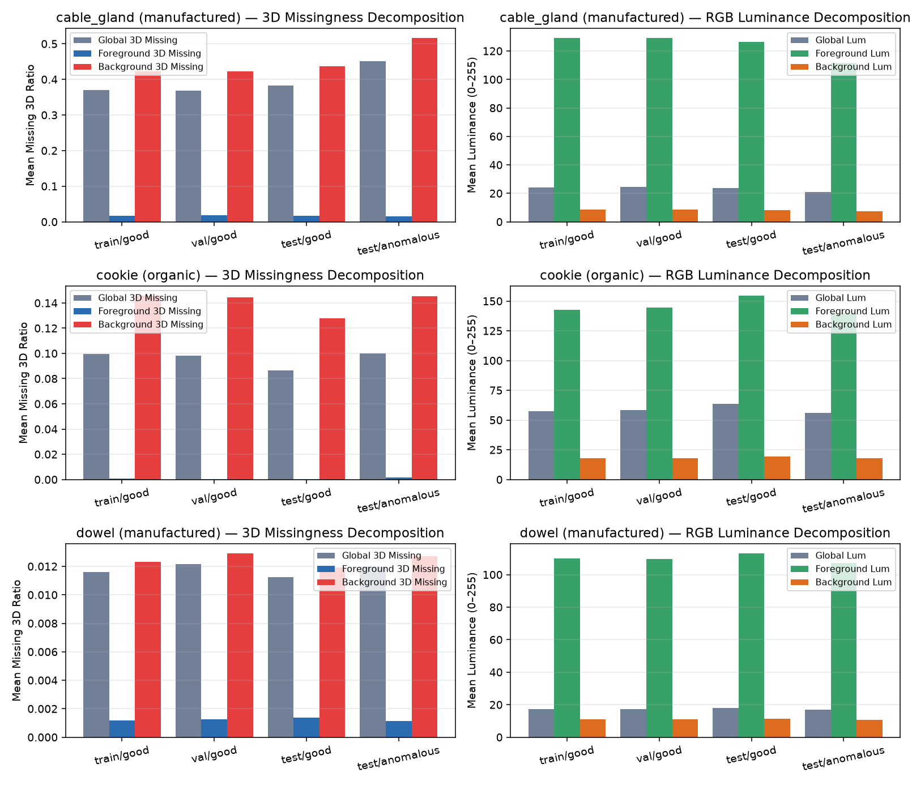
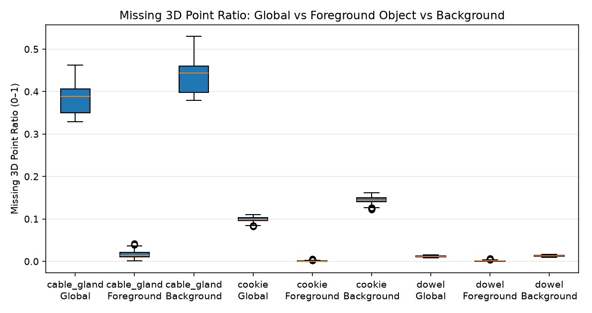
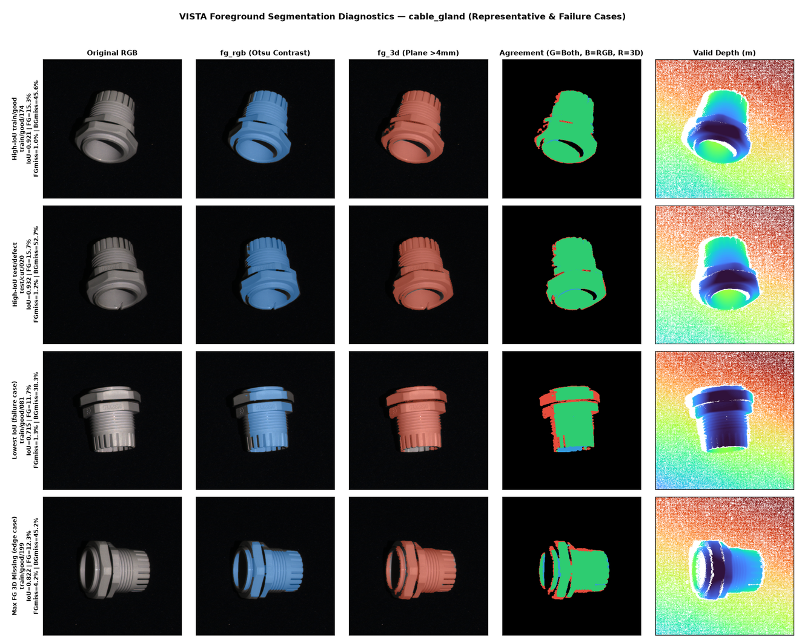
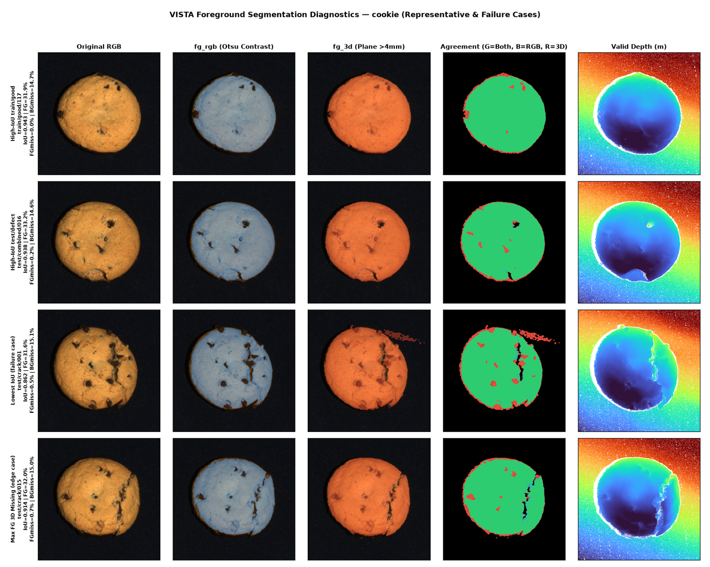
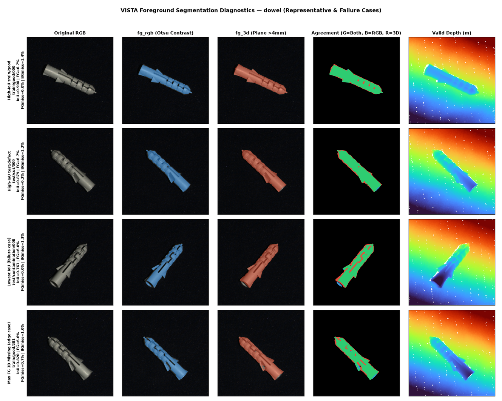
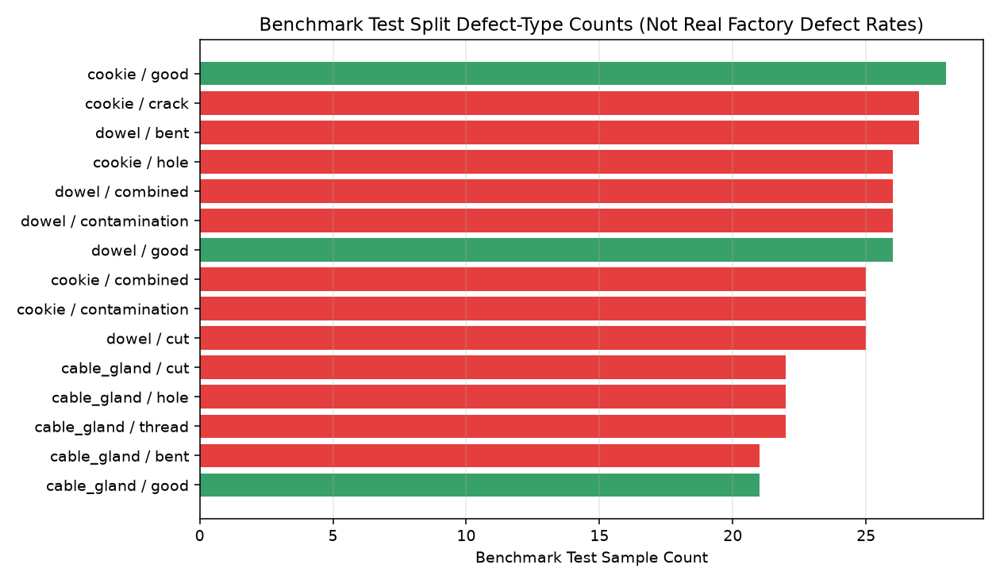

# VISTA — Exploratory Data Analysis Report (MVTec 3D-AD)

- **Generated (UTC):** `2026-11-24T20:33:57.095491+00:00`
- **Immutable Gold Snapshot ID:** `snap_1_0_0_silver_v1_172131d3_a3cd04efd735`
- **Snapshot Manifest SHA-256:** `1c50ca3d4956c6fc1c024d4a9ea7126c14364687c909fedc155d2fc5061b2440`
- **Telemetry Cutoff (UTC):** `2026-11-24T20:33:13.666710+00:00`
- **Dataset:** `mvtec_3d_ad` version `1.0.0` (`CC BY-NC-SA 4.0 (Non-Commercial Academic/Research Use Only)`)
- **Preprocessing Version:** `silver_v1` (config hash `172131d30e11d64f`)
- **Ingested Categories Covered (3 of 10):** `cable_gland, cookie, dowel`
- **Total Indexed Samples:** `1169`
- **Training Mart Test-Leakage Check (`mart_training_ready_samples` where `split='test'`):** `0` rows
- **Training Mart Partitions:** `train=721, validation=79`

> **Methodological Safeguards:**
> 1. MVTec 3D-AD is a curated academic benchmark; `test` defect proportions reflect benchmark design and **must not** be interpreted as real industrial factory defect rates.
> 2. All ML-facing normalization parameters (`normalization_artifacts`) are fitted **exclusively on eligible `train` samples** and applied frozen to `validation` and `test`.
> 3. Foreground masks (`fg_otsu_plane_v1`) are strictly unsupervised (RGB Otsu contrast + 3D border support-plane residual); benchmark ground-truth defect masks are **never** used to compute quality features.
> 4. Associations below are strictly descriptive/statistical observations, not causal proofs.

---

## 1. Dataset Inventory & Split Coverage (Q1)

### Inventory by Category and Split

Source SQL: `analytics/sql/01_dataset_inventory.sql`

| category_name | material_type | split | sample_count | passed_count | warned_count | quarantined_count | failed_count | pass_pct | raw_size_mb | silver_ready_count | reliable_normal_count |
| --- | --- | --- | --- | --- | --- | --- | --- | --- | --- | --- | --- |
| cable_gland | manufactured | test | 108 | 88 | 20 | 0 | 0 | 81.4800 | 219.9100 | 108 | 108 |
| cable_gland | manufactured | train | 223 | 151 | 72 | 0 | 0 | 67.7100 | 456.8800 | 223 | 223 |
| cable_gland | manufactured | validation | 23 | 14 | 9 | 0 | 0 | 60.8700 | 47.1100 | 23 | 23 |
| cookie | organic | test | 131 | 106 | 25 | 0 | 0 | 80.9200 | 425.1900 | 131 | 131 |
| cookie | organic | train | 210 | 127 | 83 | 0 | 0 | 60.4800 | 681.1400 | 210 | 210 |
| cookie | organic | validation | 22 | 15 | 7 | 0 | 0 | 68.1800 | 71.3200 | 22 | 22 |
| dowel | manufactured | test | 130 | 108 | 22 | 0 | 0 | 83.0800 | 264.1000 | 130 | 130 |
| dowel | manufactured | train | 288 | 179 | 109 | 0 | 0 | 62.1500 | 585.5400 | 288 | 288 |
| dowel | manufactured | validation | 34 | 26 | 8 | 0 | 0 | 76.4700 | 69.0900 | 34 | 34 |

## 2. Cross-Category Comparison: Organic vs Manufactured & Generalization Assessment

### Organic vs Manufactured Category Comparison (SQL)

Source SQL: `analytics/sql/16_cross_category_organic_vs_manufactured.sql`

| material_type | category_name | sample_count | global_brightness | fg_brightness | bg_brightness | fg_sharpness_lap | global_missing_3d_pct | fg_missing_3d_pct | bg_missing_3d_pct | mean_fg_area_pct | mean_fg_3d_area_pct | mean_fg_rgb_3d_iou | median_fg_rgb_3d_iou | min_fg_rgb_3d_iou | low_iou_failure_count | low_iou_failure_pct | mean_plane_inlier_ratio |
| --- | --- | --- | --- | --- | --- | --- | --- | --- | --- | --- | --- | --- | --- | --- | --- | --- | --- |
| manufactured | cable_gland | 354 | 23.3700 | 124.7800 | 8.1900 | 301.0300 | 39.0300 | 1.6100 | 44.6800 | 13.1100 | 14.8700 | 0.8428 | 0.8467 | 0.7153 | 0 | 0.0000 | 1.0000 |
| manufactured | dowel | 452 | 17.2800 | 109.5100 | 10.9500 | 157.6300 | 1.1700 | 0.1200 | 1.2400 | 6.4200 | 7.5700 | 0.8187 | 0.8178 | 0.7615 | 0 | 0.0000 | 1.0000 |
| organic | cookie | 363 | 57.6100 | 142.7600 | 17.9100 | 103.4700 | 9.8700 | 0.0900 | 14.4300 | 31.7900 | 34.9900 | 0.9071 | 0.9077 | 0.8618 | 0 | 0.0000 | 0.9945 |

### Cross-Category Generalization Matrix (Testing Single-Category Hypotheses Across Categories)

The table below tests whether patterns observed in `cable_gland` (strong negative global brightness-vs-3D-missingness correlation collapsing on foreground, high RGB-3D segmentation agreement, and large background-driven train→test shifts) generalize across all ingested categories:

| category | material_type | n | global_spearman | fg_spearman | fg_partial_spearman | fg_rgb_3d_iou_mean_min | fg_3d_missing_mean | bg_3d_missing_mean | bg_miss_test_shift | fg_miss_test_shift |
| --- | --- | --- | --- | --- | --- | --- | --- | --- | --- | --- |
| cable_gland | manufactured | 354 | -0.9032 | 0.0270 (p=0.613) | -0.0383 (p=0.473) | 0.843 (min 0.715) | 1.61% | 44.68% | +2.68 SD | -0.08 SD |
| cookie | organic | 363 | -0.6990 | -0.4167 (p=1.12e-16) | -0.5339 (p=3.83e-28) | 0.907 (min 0.862) | 0.09% | 14.43% | -0.81 SD | +3.37 SD |
| dowel | manufactured | 452 | -0.3906 | -0.1108 (p=0.0184) | -0.1242 (p=0.00821) | 0.819 (min 0.761) | 0.12% | 1.24% | +0.14 SD | -0.01 SD |

## 3. Global vs Foreground-Aware Quality Decomposition (P1 Q1 & Q4)

### Global vs Foreground vs Background Quality Metrics

Source SQL: `analytics/sql/11_foreground_vs_global_quality.sql`

| category_name | material_type | split | sample_count | global_rgb_brightness | fg_rgb_brightness | bg_rgb_brightness | global_sharpness_lap | fg_sharpness_lap | global_missing_3d_pct | fg_missing_3d_pct | bg_missing_3d_pct | global_minus_fg_missing_pp | fg_area_pct | mean_fg_rgb_3d_iou | mean_fg_center_offset |
| --- | --- | --- | --- | --- | --- | --- | --- | --- | --- | --- | --- | --- | --- | --- | --- |
| cable_gland | manufactured | test | 108 | 21.4600 | 114.5600 | 7.4700 | 52.7400 | 244.8000 | 43.7400 | 1.5500 | 50.1400 | 42.1900 | 13.1600 | 0.8459 | 0.0478 |
| cable_gland | manufactured | train | 223 | 24.1900 | 129.2800 | 8.5000 | 72.6200 | 330.2000 | 36.9800 | 1.6200 | 42.3000 | 35.3600 | 13.0700 | 0.8416 | 0.0453 |
| cable_gland | manufactured | validation | 23 | 24.3600 | 129.1800 | 8.4800 | 65.0600 | 282.2800 | 36.8300 | 1.8000 | 42.1800 | 35.0300 | 13.2500 | 0.8393 | 0.0498 |
| cookie | organic | test | 131 | 57.7600 | 143.0100 | 18.2200 | 92.0800 | 104.9700 | 9.7200 | 0.1400 | 14.1500 | 9.5800 | 31.6600 | 0.9032 | 0.0152 |
| cookie | organic | train | 210 | 57.4400 | 142.4200 | 17.7300 | 88.0600 | 102.7700 | 9.9700 | 0.0600 | 14.6000 | 9.9100 | 31.8500 | 0.9087 | 0.0140 |
| cookie | organic | validation | 22 | 58.4500 | 144.4900 | 17.8700 | 87.7500 | 101.2200 | 9.8400 | 0.0400 | 14.4600 | 9.8000 | 32.0600 | 0.9161 | 0.0129 |
| dowel | manufactured | test | 130 | 17.0400 | 108.2500 | 10.8500 | 58.6200 | 158.9200 | 1.1800 | 0.1200 | 1.2600 | 1.0600 | 6.3600 | 0.8132 | 0.0552 |
| dowel | manufactured | train | 288 | 17.3800 | 110.0700 | 10.9900 | 62.4400 | 157.5300 | 1.1600 | 0.1200 | 1.2300 | 1.0400 | 6.4500 | 0.8208 | 0.0580 |
| dowel | manufactured | validation | 34 | 17.3600 | 109.5700 | 10.9800 | 61.0500 | 153.5100 | 1.2200 | 0.1200 | 1.2900 | 1.1000 | 6.4700 | 0.8220 | 0.0552 |

### Global RGB Photometric Summary by Category and Split

Source SQL: `analytics/sql/03_rgb_quality.sql`

| category_name | material_type | split | sample_count | mean_brightness | median_brightness | std_brightness | mean_contrast_rms | mean_contrast_p5_p95 | mean_laplacian_var | median_laplacian_var | mean_saturation | mean_underexposed_pct | mean_overexposed_pct |
| --- | --- | --- | --- | --- | --- | --- | --- | --- | --- | --- | --- | --- | --- |
| cable_gland | manufactured | test | 108 | 21.4600 | 21.1200 | 1.1400 | 0.1492 | 122.7000 | 52.7400 | 50.7000 | 0.2716 | 83.9400 | 0.0100 |
| cable_gland | manufactured | train | 223 | 24.1900 | 24.0500 | 1.2300 | 0.1680 | 138.1200 | 72.6200 | 66.2800 | 0.2754 | 83.6500 | 0.0300 |
| cable_gland | manufactured | validation | 23 | 24.3600 | 24.3400 | 0.5900 | 0.1687 | 137.9400 | 65.0600 | 62.5300 | 0.2767 | 83.4900 | 0.0400 |
| cookie | organic | test | 131 | 57.7600 | 56.3900 | 3.8700 | 0.2362 | 155.1400 | 92.0800 | 88.3800 | 0.4382 | 25.0000 | 0.0000 |
| cookie | organic | train | 210 | 57.4400 | 57.4900 | 2.0200 | 0.2361 | 154.1300 | 88.0600 | 88.7200 | 0.4367 | 27.2400 | 0.0000 |
| cookie | organic | validation | 22 | 58.4500 | 58.2100 | 1.3900 | 0.2400 | 155.8600 | 87.7500 | 84.9100 | 0.4357 | 25.7700 | 0.0000 |
| dowel | manufactured | test | 130 | 17.0400 | 16.8000 | 0.9200 | 0.0991 | 76.5900 | 58.6200 | 56.5500 | 0.3221 | 87.1300 | 0.0000 |
| dowel | manufactured | train | 288 | 17.3800 | 17.2300 | 0.6800 | 0.1015 | 79.1300 | 62.4400 | 62.8600 | 0.3252 | 86.4300 | 0.0000 |
| dowel | manufactured | validation | 34 | 17.3600 | 17.4700 | 0.4400 | 0.1011 | 78.9900 | 61.0500 | 61.6400 | 0.3209 | 86.7700 | 0.0000 |

### 3D Geometric Quality by Category

Source SQL: `analytics/sql/04_geometry_quality.sql`

| category_name | material_type | preprocessing_version | sample_count | mean_valid_3d_pct | mean_missing_3d_pct | median_missing_3d_pct | max_missing_3d_pct | mean_z_meters | mean_z_std_meters | geometry_outlier_count |
| --- | --- | --- | --- | --- | --- | --- | --- | --- | --- | --- |
| cable_gland | manufactured | silver_v1 | 354 | 60.9700 | 39.0300 | 38.8100 | 46.2200 | 0.6560 | 0.0173 | 21 |
| cookie | organic | silver_v1 | 363 | 90.1300 | 9.8700 | 9.8700 | 11.0200 | 0.5489 | 0.0148 | 2 |
| dowel | manufactured | silver_v1 | 452 | 98.8300 | 1.1700 | 1.1700 | 1.5400 | 0.5558 | 0.0096 | 21 |

## 4. Visual Foreground Segmentation Examples & Failure Cases

Each panel shows 4 deterministically selected real samples per category: (1) highest RGB-3D IoU `train/good`, (2) highest RGB-3D IoU `test/defect`, (3) **lowest `fg_rgb_3d_iou` failure case**, and (4) **highest foreground 3D missingness edge case**. Columns show Original RGB, unsupervised `fg_rgb` (Otsu contrast), unsupervised `fg_3d` (plane residual `> 4 mm`), RGB-vs-3D Agreement (Green = both, Blue = RGB-only, Red = 3D-only), and Valid Depth.

### Foreground Visual Diagnostics — `cable_gland`

| case_role | sample_key | split | defect_type | fg_rgb_3d_iou | fg_rgb_area | fg_3d_area | fg_3d_missing | bg_3d_missing | plane_inlier_ratio |
| --- | --- | --- | --- | --- | --- | --- | --- | --- | --- |
| High-IoU train/good | 1.0.0:cable_gland:train:good:174 | train | good | 0.9215 | 15.34% | 16.27% | 1.02% | 45.60% | 1.0000 |
| High-IoU test/defect | 1.0.0:cable_gland:test:cut:020 | test | cut | 0.9316 | 15.71% | 16.45% | 1.23% | 52.75% | 1.0000 |
| Lowest IoU (failure case) | 1.0.0:cable_gland:train:good:081 | train | good | 0.7153 | 11.69% | 14.85% | 1.29% | 38.30% | 1.0000 |
| Max FG 3D Missing (edge case) | 1.0.0:cable_gland:train:good:199 | train | good | 0.8219 | 12.29% | 13.53% | 4.23% | 45.21% | 1.0000 |

### Foreground Visual Diagnostics — `cookie`

| case_role | sample_key | split | defect_type | fg_rgb_3d_iou | fg_rgb_area | fg_3d_area | fg_3d_missing | bg_3d_missing | plane_inlier_ratio |
| --- | --- | --- | --- | --- | --- | --- | --- | --- | --- |
| High-IoU train/good | 1.0.0:cookie:train:good:117 | train | good | 0.9430 | 31.89% | 33.80% | 0.04% | 14.69% | 1.0000 |
| High-IoU test/defect | 1.0.0:cookie:test:combined:016 | test | combined | 0.9382 | 33.16% | 35.20% | 0.17% | 14.58% | 1.0000 |
| Lowest IoU (failure case) | 1.0.0:cookie:test:crack:001 | test | crack | 0.8618 | 31.55% | 36.18% | 0.46% | 15.14% | 0.9745 |
| Max FG 3D Missing (edge case) | 1.0.0:cookie:test:crack:015 | test | crack | 0.9135 | 31.98% | 34.29% | 0.65% | 15.01% | 1.0000 |

### Foreground Visual Diagnostics — `dowel`

| case_role | sample_key | split | defect_type | fg_rgb_3d_iou | fg_rgb_area | fg_3d_area | fg_3d_missing | bg_3d_missing | plane_inlier_ratio |
| --- | --- | --- | --- | --- | --- | --- | --- | --- | --- |
| High-IoU train/good | 1.0.0:dowel:train:good:000 | train | good | 0.8995 | 6.74% | 7.46% | 0.01% | 1.37% | 1.0000 |
| High-IoU test/defect | 1.0.0:dowel:test:cut:009 | test | cut | 0.8788 | 6.66% | 7.45% | 0.17% | 1.22% | 1.0000 |
| Lowest IoU (failure case) | 1.0.0:dowel:test:contamination:008 | test | contamination | 0.7615 | 5.98% | 7.51% | 0.03% | 1.28% | 1.0000 |
| Max FG 3D Missing (edge case) | 1.0.0:dowel:train:good:281 | train | good | 0.8198 | 6.58% | 7.60% | 0.74% | 1.01% | 1.0000 |

## 5. Cross-Modal Association: Global vs Background-Adjusted Foreground (Q5 & P1 Q2)

### Global Cross-Modal Pearson Correlations (SQL)

Source SQL: `analytics/sql/05_cross_modal_quality.sql`

| category_name | sample_count | corr_brightness_vs_missing3d | corr_contrast_vs_missing3d | corr_sharpness_vs_missing3d | corr_saturation_vs_missing3d | corr_underexp_vs_missing3d | corr_overexp_vs_missing3d |
| --- | --- | --- | --- | --- | --- | --- | --- |
| cable_gland | 354 | -0.9392 | -0.7155 | -0.5713 | -0.3017 | 0.2767 | -0.1596 |
| cookie | 363 | -0.7576 | -0.6882 | -0.7086 | -0.1506 | 0.9419 | -0.0716 |
| dowel | 452 | -0.3923 | -0.1161 | -0.4917 | 0.3596 | 0.4776 | -0.0147 |

### Foreground vs Global Cross-Modal Correlations (SQL)

Source SQL: `analytics/sql/12_cross_modal_bg_adjusted.sql`

| category_name | sample_count | global_corr_bright_vs_miss3d | fg_corr_bright_vs_miss3d | global_corr_sharp_vs_miss3d | fg_corr_sharp_vs_miss3d | bg_corr_bright_vs_miss3d | corr_footprint_vs_global_miss3d | corr_footprint_vs_fg_miss3d |
| --- | --- | --- | --- | --- | --- | --- | --- | --- |
| cable_gland | 354 | -0.9392 | -0.0266 | -0.5713 | 0.1607 | -0.9091 | -0.0427 | -0.0851 |
| cookie | 363 | -0.7576 | -0.3276 | -0.7086 | -0.0320 | -0.8997 | -0.2590 | -0.0767 |
| dowel | 452 | -0.3923 | -0.1513 | -0.4917 | 0.0150 | -0.4381 | -0.2818 | 0.0748 |

### Statistical Correlation Analysis (Spearman, Pearson, 95% Bootstrap CIs, and Partial Spearman)

Partial Spearman controls simultaneously for object footprint (`fg_area_ratio`) and dark-table background 3D dropout (`bg_missing_3d_ratio`):

| category | metric_pair | n | spearman_95ci | spearman_p | pearson_95ci | partial_spearman_bg_adj |
| --- | --- | --- | --- | --- | --- | --- |
| cable_gland | Global brightness vs Global 3D missing | 354 | -0.9032 [-0.9158, -0.8837] | 2.4e-131 | -0.9392 [-0.9481, -0.9306] | -0.5782 (p=5.76e-33) |
| cable_gland | Global sharpness vs Global 3D missing | 354 | -0.5017 [-0.5750, -0.4168] | 5.75e-24 | -0.5713 [-0.6283, -0.5100] | -0.0434 (p=0.416) |
| cable_gland | Foreground brightness vs Foreground 3D missing | 354 | 0.0270 [-0.0709, 0.1264] | 0.613 | -0.0266 [-0.1148, 0.0603] | -0.0383 (p=0.473) |
| cable_gland | Foreground sharpness vs Foreground 3D missing | 354 | 0.2508 [0.1483, 0.3442] | 1.77e-06 | 0.1607 [0.0677, 0.2500] | 0.2979 (p=1.1e-08) |
| cookie | Global brightness vs Global 3D missing | 363 | -0.6990 [-0.7577, -0.6335] | 1.58e-54 | -0.7576 [-0.8087, -0.6997] | -0.3162 (p=7.17e-10) |
| cookie | Global sharpness vs Global 3D missing | 363 | -0.5927 [-0.6604, -0.5173] | 8.27e-36 | -0.7086 [-0.7519, -0.6576] | -0.1961 (p=0.000169) |
| cookie | Foreground brightness vs Foreground 3D missing | 363 | -0.4167 [-0.5043, -0.3175] | 1.12e-16 | -0.3276 [-0.4093, -0.2431] | -0.5339 (p=3.83e-28) |
| cookie | Foreground sharpness vs Foreground 3D missing | 363 | -0.0783 [-0.1746, 0.0295] | 0.136 | -0.0320 [-0.1289, 0.0745] | -0.0988 (p=0.0599) |
| dowel | Global brightness vs Global 3D missing | 452 | -0.3906 [-0.4655, -0.3050] | 6.31e-18 | -0.3923 [-0.4637, -0.3166] | -0.0771 (p=0.102) |
| dowel | Global sharpness vs Global 3D missing | 452 | -0.5128 [-0.5800, -0.4370] | 1.12e-31 | -0.4917 [-0.5580, -0.4279] | -0.0460 (p=0.329) |
| dowel | Foreground brightness vs Foreground 3D missing | 452 | -0.1108 [-0.1996, -0.0208] | 0.0184 | -0.1513 [-0.2362, -0.0594] | -0.1242 (p=0.00821) |
| dowel | Foreground sharpness vs Foreground 3D missing | 452 | -0.0579 [-0.1476, 0.0352] | 0.219 | 0.0150 [-0.0876, 0.1186] | -0.0728 (p=0.122) |

## 6. Train-to-Test Distribution Shift & Framing / Footprint Effects (P1 Q3 & Q5)

### Train vs Validation vs Test Standardized Shifts (SQL)

Source SQL: `analytics/sql/13_train_test_distribution_shift.sql`

| category_name | split | feature_name | modality_group | sample_count | train_mean | split_mean | train_median | split_median | shift_in_train_sd |
| --- | --- | --- | --- | --- | --- | --- | --- | --- | --- |
| cable_gland | test | bg_missing_3d_ratio | 3d_background | 108 | 0.4230 | 0.5014 | 0.4394 | 0.5149 | 2.6726 |
| cable_gland | test | global_missing_3d_ratio | 3d_global | 108 | 0.3698 | 0.4374 | 0.3826 | 0.4489 | 2.6344 |
| cable_gland | test | global_rgb_brightness_mean | rgb_global | 108 | 24.1885 | 21.4636 | 24.0465 | 21.1207 | -2.2085 |
| cable_gland | test | bg_rgb_brightness_mean | rgb_background | 108 | 8.5014 | 7.4732 | 8.4978 | 7.3572 | -1.9027 |
| cable_gland | test | fg_rgb_brightness_mean | rgb_foreground | 108 | 129.2842 | 114.5567 | 127.8553 | 115.9762 | -1.2249 |
| cable_gland | test | fg_rgb_laplacian_var | rgb_foreground | 108 | 330.1957 | 244.8035 | 313.5132 | 248.9153 | -0.6632 |
| cable_gland | test | fg_rgb_3d_iou | cross_modal | 108 | 0.8416 | 0.8459 | 0.8467 | 0.8481 | 0.0973 |
| cable_gland | test | fg_center_offset_norm | framing | 108 | 0.0453 | 0.0478 | 0.0393 | 0.0421 | 0.0921 |
| cable_gland | test | fg_missing_3d_ratio | 3d_foreground | 108 | 0.0162 | 0.0155 | 0.0141 | 0.0135 | -0.0827 |
| cable_gland | test | fg_area_ratio | framing | 108 | 0.1307 | 0.1316 | 0.1269 | 0.1266 | 0.0768 |
| cable_gland | validation | fg_rgb_laplacian_var | rgb_foreground | 23 | 330.1957 | 282.2823 | 313.5132 | 274.2978 | -0.3721 |
| cable_gland | validation | fg_missing_3d_ratio | 3d_foreground | 23 | 0.0162 | 0.0180 | 0.0141 | 0.0141 | 0.2212 |
| cable_gland | validation | fg_center_offset_norm | framing | 23 | 0.0453 | 0.0498 | 0.0393 | 0.0370 | 0.1678 |
| cable_gland | validation | fg_area_ratio | framing | 23 | 0.1307 | 0.1325 | 0.1269 | 0.1270 | 0.1579 |
| cable_gland | validation | global_rgb_brightness_mean | rgb_global | 23 | 24.1885 | 24.3619 | 24.0465 | 24.3361 | 0.1406 |
| cable_gland | validation | global_missing_3d_ratio | 3d_global | 23 | 0.3698 | 0.3683 | 0.3826 | 0.3687 | -0.0576 |
| cable_gland | validation | fg_rgb_3d_iou | cross_modal | 23 | 0.8416 | 0.8393 | 0.8467 | 0.8397 | -0.0530 |
| cable_gland | validation | bg_missing_3d_ratio | 3d_background | 23 | 0.4230 | 0.4218 | 0.4394 | 0.4225 | -0.0387 |
| cable_gland | validation | bg_rgb_brightness_mean | rgb_background | 23 | 8.5014 | 8.4818 | 8.4978 | 8.4869 | -0.0363 |
| cable_gland | validation | fg_rgb_brightness_mean | rgb_foreground | 23 | 129.2842 | 129.1806 | 127.8553 | 130.2410 | -0.0086 |
| cookie | test | fg_missing_3d_ratio | 3d_foreground | 131 | 0.0006 | 0.0014 | 0.0005 | 0.0012 | 3.3627 |
| cookie | test | bg_rgb_brightness_mean | rgb_background | 131 | 17.7272 | 18.2238 | 17.8039 | 17.9506 | 1.1602 |
| cookie | test | bg_missing_3d_ratio | 3d_background | 131 | 0.1460 | 0.1415 | 0.1445 | 0.1432 | -0.8036 |
| cookie | test | global_missing_3d_ratio | 3d_global | 131 | 0.0997 | 0.0972 | 0.0987 | 0.0991 | -0.6029 |
| cookie | test | fg_rgb_3d_iou | cross_modal | 131 | 0.9087 | 0.9032 | 0.9085 | 0.9036 | -0.3773 |
| cookie | test | fg_rgb_laplacian_var | rgb_foreground | 131 | 102.7678 | 104.9661 | 102.2022 | 104.1535 | 0.3153 |
| cookie | test | fg_area_ratio | framing | 131 | 0.3185 | 0.3166 | 0.3184 | 0.3193 | -0.1912 |
| cookie | test | global_rgb_brightness_mean | rgb_global | 131 | 57.4388 | 57.7553 | 57.4923 | 56.3885 | 0.1564 |
| cookie | test | fg_center_offset_norm | framing | 131 | 0.0140 | 0.0152 | 0.0130 | 0.0138 | 0.1558 |
| cookie | test | fg_rgb_brightness_mean | rgb_foreground | 131 | 142.4154 | 143.0127 | 142.5358 | 140.8430 | 0.1420 |
| cookie | validation | fg_missing_3d_ratio | 3d_foreground | 22 | 0.0006 | 0.0004 | 0.0005 | 0.0004 | -0.5415 |
| cookie | validation | fg_rgb_3d_iou | cross_modal | 22 | 0.9087 | 0.9161 | 0.9085 | 0.9212 | 0.5064 |
| cookie | validation | global_rgb_brightness_mean | rgb_global | 22 | 57.4388 | 58.4494 | 57.4923 | 58.2080 | 0.4995 |
| cookie | validation | fg_rgb_brightness_mean | rgb_foreground | 22 | 142.4154 | 144.4854 | 142.5358 | 142.4089 | 0.4921 |
| cookie | validation | bg_rgb_brightness_mean | rgb_background | 22 | 17.7272 | 17.8673 | 17.8039 | 17.8896 | 0.3272 |
| cookie | validation | global_missing_3d_ratio | 3d_global | 22 | 0.0997 | 0.0984 | 0.0987 | 0.0981 | -0.3083 |
| cookie | validation | bg_missing_3d_ratio | 3d_background | 22 | 0.1460 | 0.1446 | 0.1445 | 0.1438 | -0.2464 |
| cookie | validation | fg_area_ratio | framing | 22 | 0.3185 | 0.3206 | 0.3184 | 0.3197 | 0.2278 |
| cookie | validation | fg_rgb_laplacian_var | rgb_foreground | 22 | 102.7678 | 101.2237 | 102.2022 | 101.7429 | -0.2215 |
| cookie | validation | fg_center_offset_norm | framing | 22 | 0.0140 | 0.0129 | 0.0130 | 0.0127 | -0.1346 |
| dowel | test | fg_rgb_brightness_mean | rgb_foreground | 130 | 110.0696 | 108.2495 | 109.8015 | 107.1154 | -0.5499 |
| dowel | test | global_rgb_brightness_mean | rgb_global | 130 | 17.3759 | 17.0396 | 17.2309 | 16.7996 | -0.4949 |
| dowel | test | fg_area_ratio | framing | 130 | 0.0645 | 0.0636 | 0.0646 | 0.0633 | -0.3359 |
| dowel | test | bg_rgb_brightness_mean | rgb_background | 130 | 10.9886 | 10.8495 | 10.6519 | 10.6322 | -0.2712 |
| dowel | test | fg_rgb_3d_iou | cross_modal | 130 | 0.8208 | 0.8132 | 0.8209 | 0.8098 | -0.2461 |
| dowel | test | global_missing_3d_ratio | 3d_global | 130 | 0.0116 | 0.0118 | 0.0115 | 0.0119 | 0.1483 |
| dowel | test | bg_missing_3d_ratio | 3d_background | 130 | 0.0123 | 0.0126 | 0.0123 | 0.0126 | 0.1412 |
| dowel | test | fg_center_offset_norm | framing | 130 | 0.0580 | 0.0552 | 0.0564 | 0.0554 | -0.0983 |
| dowel | test | fg_rgb_laplacian_var | rgb_foreground | 130 | 157.5286 | 158.9231 | 155.7015 | 150.8023 | 0.0547 |
| dowel | test | fg_missing_3d_ratio | 3d_foreground | 130 | 0.0012 | 0.0012 | 0.0007 | 0.0007 | -0.0135 |
| dowel | validation | global_missing_3d_ratio | 3d_global | 34 | 0.0116 | 0.0122 | 0.0115 | 0.0121 | 0.3653 |
| dowel | validation | bg_missing_3d_ratio | 3d_background | 34 | 0.0123 | 0.0129 | 0.0123 | 0.0128 | 0.3616 |
| dowel | validation | fg_rgb_laplacian_var | rgb_foreground | 34 | 157.5286 | 153.5143 | 155.7015 | 152.8110 | -0.1574 |
| dowel | validation | fg_rgb_brightness_mean | rgb_foreground | 34 | 110.0696 | 109.5699 | 109.8015 | 110.2691 | -0.1510 |
| dowel | validation | fg_center_offset_norm | framing | 34 | 0.0580 | 0.0552 | 0.0564 | 0.0536 | -0.0981 |
| dowel | validation | fg_area_ratio | framing | 34 | 0.0645 | 0.0647 | 0.0646 | 0.0648 | 0.0781 |
| dowel | validation | fg_rgb_3d_iou | cross_modal | 34 | 0.8208 | 0.8220 | 0.8209 | 0.8160 | 0.0403 |
| dowel | validation | fg_missing_3d_ratio | 3d_foreground | 34 | 0.0012 | 0.0012 | 0.0007 | 0.0008 | 0.0377 |
| dowel | validation | global_rgb_brightness_mean | rgb_global | 34 | 17.3759 | 17.3569 | 17.2309 | 17.4667 | -0.0279 |
| dowel | validation | bg_rgb_brightness_mean | rgb_background | 34 | 10.9886 | 10.9806 | 10.6519 | 11.0301 | -0.0155 |

### Two-Sample KS Tests & Retrospective Benchmark Group Decomposition

Note: The `test/good` vs `test/anomalous` columns below are strictly retrospective benchmark diagnostics to expose potential acquisition shortcuts, never model inputs.

| category | feature | train_mean | test_mean | test_shift_sd | test_good_shift_sd | test_anom_shift_sd | ks_stat | ks_p |
| --- | --- | --- | --- | --- | --- | --- | --- | --- |
| cable_gland | global_missing_3d_ratio | 0.3698 | 0.4374 | 2.6404 | 0.4878 | 3.1600 | 0.8056 | 2.4e-48 |
| cable_gland | bg_missing_3d_ratio | 0.4230 | 0.5014 | 2.6786 | 0.4824 | 3.2087 | 0.8056 | 2.4e-48 |
| cable_gland | fg_missing_3d_ratio | 0.0162 | 0.0155 | -0.0829 | 0.1152 | -0.1307 | 0.0980 | 0.45 |
| cable_gland | global_rgb_brightness_mean | 24.1885 | 21.4636 | -2.2134 | -0.5284 | -2.6201 | 0.7963 | 5.43e-47 |
| cable_gland | bg_rgb_brightness_mean | 8.5014 | 7.4732 | -1.9070 | -0.5102 | -2.2441 | 0.7517 | 3.81e-41 |
| cable_gland | fg_rgb_brightness_mean | 129.2842 | 114.5567 | -1.2276 | -0.2426 | -1.4654 | 0.5553 | 2.89e-21 |
| cable_gland | fg_rgb_laplacian_var | 330.1957 | 244.8035 | -0.6647 | -0.1534 | -0.7881 | 0.3451 | 3.2e-08 |
| cable_gland | fg_area_ratio | 0.1307 | 0.1316 | 0.0769 | -0.0243 | 0.1014 | 0.0748 | 0.774 |
| cable_gland | fg_rgb_3d_iou | 0.8416 | 0.8459 | 0.0976 | 0.0284 | 0.1143 | 0.1298 | 0.154 |
| cable_gland | fg_center_offset_norm | 0.0453 | 0.0478 | 0.0924 | -0.2799 | 0.1822 | 0.0960 | 0.477 |
| cookie | global_missing_3d_ratio | 0.0997 | 0.0972 | -0.6043 | -3.1587 | 0.0901 | 0.3283 | 3.14e-08 |
| cookie | bg_missing_3d_ratio | 0.1460 | 0.1415 | -0.8056 | -3.2734 | -0.1347 | 0.3998 | 4.46e-12 |
| cookie | fg_missing_3d_ratio | 0.0006 | 0.0014 | 3.3708 | -0.4029 | 4.3966 | 0.5766 | 2.24e-25 |
| cookie | global_rgb_brightness_mean | 57.4388 | 57.7553 | 0.1568 | 3.0355 | -0.6257 | 0.2409 | 0.000132 |
| cookie | bg_rgb_brightness_mean | 17.7272 | 18.2238 | 1.1630 | 4.2927 | 0.3121 | 0.3369 | 1.2e-08 |
| cookie | fg_rgb_brightness_mean | 142.4154 | 143.0127 | 0.1423 | 2.9308 | -0.6157 | 0.2539 | 4.44e-05 |
| cookie | fg_rgb_laplacian_var | 102.7678 | 104.9661 | 0.3161 | 1.8828 | -0.1098 | 0.2007 | 0.00247 |
| cookie | fg_area_ratio | 0.3185 | 0.3166 | -0.1917 | 0.7471 | -0.4469 | 0.1289 | 0.123 |
| cookie | fg_rgb_3d_iou | 0.9087 | 0.9032 | -0.3782 | 0.0168 | -0.4856 | 0.1763 | 0.0113 |
| cookie | fg_center_offset_norm | 0.0140 | 0.0152 | 0.1561 | -0.4077 | 0.3094 | 0.0822 | 0.61 |
| dowel | global_missing_3d_ratio | 0.0116 | 0.0118 | 0.1485 | -0.2491 | 0.2480 | 0.1167 | 0.158 |
| dowel | bg_missing_3d_ratio | 0.0123 | 0.0126 | 0.1415 | -0.2546 | 0.2405 | 0.1063 | 0.242 |
| dowel | fg_missing_3d_ratio | 0.0012 | 0.0012 | -0.0135 | 0.1322 | -0.0500 | 0.0557 | 0.925 |
| dowel | global_rgb_brightness_mean | 17.3759 | 17.0396 | -0.4958 | 0.6607 | -0.7849 | 0.3237 | 7.94e-09 |
| dowel | bg_rgb_brightness_mean | 10.9886 | 10.8495 | -0.2716 | 0.5216 | -0.4699 | 0.3385 | 1.25e-09 |
| dowel | fg_rgb_brightness_mean | 110.0696 | 108.2495 | -0.5508 | 0.9487 | -0.9257 | 0.3762 | 7.77e-12 |
| dowel | fg_rgb_laplacian_var | 157.5286 | 158.9231 | 0.0548 | 0.2702 | 0.0009 | 0.0967 | 0.345 |
| dowel | fg_area_ratio | 0.0645 | 0.0636 | -0.3365 | -0.0090 | -0.4184 | 0.2326 | 9.5e-05 |
| dowel | fg_rgb_3d_iou | 0.8208 | 0.8132 | -0.2466 | -0.0648 | -0.2920 | 0.1454 | 0.0401 |
| dowel | fg_center_offset_norm | 0.0580 | 0.0552 | -0.0985 | -0.3447 | -0.0370 | 0.0857 | 0.493 |

## 7. Extreme Geometric Missingness & Outlier Diagnostics (Q6 & P1 Q4)

### Extreme Global vs Foreground 3D Missingness

Source SQL: `analytics/sql/14_extreme_geometric_missingness.sql`

| category_name | split | defect_type | sample_key | global_missing_3d_pct | fg_missing_3d_pct | bg_missing_3d_pct | fg_area_pct | fg_rgb_3d_iou | train_ref_geometry_outlier_flag |
| --- | --- | --- | --- | --- | --- | --- | --- | --- | --- |
| cable_gland | train | good | 1.0.0:cable_gland:train:good:199 | 40.1700 | 4.2300 | 45.2100 | 12.2900 | 0.8219 | True |
| cable_gland | validation | good | 1.0.0:cable_gland:validation:good:004 | 37.2300 | 3.9400 | 42.0700 | 12.7000 | 0.8205 | False |
| cable_gland | train | good | 1.0.0:cable_gland:train:good:006 | 34.0200 | 3.8800 | 38.5800 | 13.1200 | 0.8559 | False |
| cable_gland | train | good | 1.0.0:cable_gland:train:good:133 | 39.1100 | 3.8500 | 44.2400 | 12.7000 | 0.8404 | False |
| cable_gland | train | good | 1.0.0:cable_gland:train:good:094 | 34.8300 | 3.6500 | 39.2800 | 12.4900 | 0.8210 | False |
| cable_gland | train | good | 1.0.0:cable_gland:train:good:080 | 34.6600 | 3.6300 | 39.1400 | 12.6300 | 0.8117 | False |
| cable_gland | train | good | 1.0.0:cable_gland:train:good:003 | 33.9000 | 3.6100 | 38.3800 | 12.8800 | 0.8583 | False |
| cable_gland | validation | good | 1.0.0:cable_gland:validation:good:019 | 37.0000 | 3.5500 | 41.7900 | 12.5100 | 0.8087 | False |
| cable_gland | test | hole | 1.0.0:cable_gland:test:hole:009 | 45.2700 | 3.5200 | 51.3900 | 12.7800 | 0.8656 | False |
| cable_gland | train | good | 1.0.0:cable_gland:train:good:175 | 40.0500 | 3.4900 | 45.2600 | 12.4900 | 0.8121 | False |
| cable_gland | test | good | 1.0.0:cable_gland:test:good:000 | 36.6000 | 3.4400 | 41.2600 | 12.3200 | 0.8125 | False |
| cable_gland | test | good | 1.0.0:cable_gland:test:good:011 | 38.9500 | 3.4100 | 43.9700 | 12.3600 | 0.8335 | False |
| cable_gland | validation | good | 1.0.0:cable_gland:validation:good:013 | 37.9900 | 3.3200 | 42.7000 | 11.9600 | 0.8020 | False |
| cable_gland | test | thread | 1.0.0:cable_gland:test:thread:018 | 45.4800 | 3.2700 | 51.5300 | 12.5300 | 0.8348 | False |
| cable_gland | test | thread | 1.0.0:cable_gland:test:thread:009 | 45.5000 | 3.2500 | 51.5200 | 12.4600 | 0.8425 | False |
| cable_gland | train | good | 1.0.0:cable_gland:train:good:191 | 39.9200 | 3.1800 | 45.1700 | 12.5100 | 0.8347 | False |
| cable_gland | train | good | 1.0.0:cable_gland:train:good:056 | 35.0300 | 3.1800 | 39.4500 | 12.1800 | 0.8076 | False |
| cable_gland | train | good | 1.0.0:cable_gland:train:good:087 | 34.7100 | 3.1700 | 39.1500 | 12.3300 | 0.8263 | False |
| cable_gland | train | good | 1.0.0:cable_gland:train:good:137 | 38.8100 | 3.1500 | 43.9200 | 12.5400 | 0.8292 | False |
| cable_gland | train | good | 1.0.0:cable_gland:train:good:171 | 39.9000 | 3.1400 | 45.0800 | 12.3500 | 0.8290 | False |

### Descriptive EDA Depth & Point-Cloud Outliers

Source SQL: `analytics/sql/08_depth_pointcloud_outliers.sql`

| category_name | split | defect_type | sample_key | missing_3d_ratio | missing_robust_z | z_mean_m | z_mean_robust_z | z_std_m | bbox_vol_m3 | geometry_outlier_flag | rgb_quality_outlier_flag |
| --- | --- | --- | --- | --- | --- | --- | --- | --- | --- | --- | --- |
| cable_gland | test | good | 1.0.0:cable_gland:test:good:001 | 0.3659 | -12.2830 | 0.6563 | 3.0550 | 0.0167 | 0.0006 | True | False |
| cable_gland | test | good | 1.0.0:cable_gland:test:good:000 | 0.3660 | -12.2690 | 0.6564 | 3.3400 | 0.0179 | 0.0007 | True | False |
| cable_gland | test | good | 1.0.0:cable_gland:test:good:008 | 0.3775 | -10.5630 | 0.6562 | 2.9370 | 0.0169 | 0.0006 | True | False |
| cable_gland | test | good | 1.0.0:cable_gland:test:good:014 | 0.3779 | -10.5130 | 0.6562 | 2.9510 | 0.0169 | 0.0007 | True | False |
| cable_gland | test | good | 1.0.0:cable_gland:test:good:016 | 0.3787 | -10.3940 | 0.6563 | 3.0130 | 0.0171 | 0.0007 | True | False |
| cable_gland | test | good | 1.0.0:cable_gland:test:good:004 | 0.3794 | -10.2910 | 0.6563 | 3.0880 | 0.0167 | 0.0006 | True | False |
| dowel | train | good | 1.0.0:dowel:train:good:011 | 0.0129 | 0.8030 | 0.5551 | -10.2300 | 0.0094 | 0.0003 | True | False |
| cable_gland | test | good | 1.0.0:cable_gland:test:good:012 | 0.3800 | -10.2030 | 0.6562 | 2.7600 | 0.0172 | 0.0007 | True | False |
| cable_gland | test | good | 1.0.0:cable_gland:test:good:007 | 0.3804 | -10.1370 | 0.6563 | 3.0130 | 0.0170 | 0.0006 | True | False |
| cable_gland | test | good | 1.0.0:cable_gland:test:good:017 | 0.3810 | -10.0540 | 0.6563 | 2.9620 | 0.0174 | 0.0007 | True | False |
| cable_gland | test | good | 1.0.0:cable_gland:test:good:009 | 0.3815 | -9.9770 | 0.6559 | 2.0430 | 0.0171 | 0.0006 | True | False |
| cable_gland | test | good | 1.0.0:cable_gland:test:good:013 | 0.3833 | -9.7160 | 0.6560 | 2.1850 | 0.0169 | 0.0006 | True | False |
| cable_gland | test | good | 1.0.0:cable_gland:test:good:015 | 0.3841 | -9.5920 | 0.6559 | 1.9240 | 0.0173 | 0.0006 | True | False |
| cable_gland | test | good | 1.0.0:cable_gland:test:good:005 | 0.3843 | -9.5670 | 0.6560 | 2.1790 | 0.0174 | 0.0006 | True | False |
| cable_gland | test | good | 1.0.0:cable_gland:test:good:010 | 0.3846 | -9.5140 | 0.6563 | 3.0420 | 0.0170 | 0.0006 | True | False |
| cable_gland | test | good | 1.0.0:cable_gland:test:good:019 | 0.3863 | -9.2650 | 0.6565 | 3.6320 | 0.0171 | 0.0007 | True | False |
| cable_gland | test | good | 1.0.0:cable_gland:test:good:006 | 0.3865 | -9.2380 | 0.6558 | 1.7480 | 0.0171 | 0.0006 | True | False |
| cable_gland | test | good | 1.0.0:cable_gland:test:good:003 | 0.3868 | -9.1980 | 0.6560 | 2.3010 | 0.0176 | 0.0006 | True | False |
| cable_gland | test | good | 1.0.0:cable_gland:test:good:020 | 0.3890 | -8.8670 | 0.6562 | 2.8190 | 0.0173 | 0.0006 | True | False |
| cable_gland | test | good | 1.0.0:cable_gland:test:good:011 | 0.3895 | -8.7890 | 0.6565 | 3.8030 | 0.0173 | 0.0007 | True | False |
| cable_gland | test | good | 1.0.0:cable_gland:test:good:018 | 0.3912 | -8.5430 | 0.6563 | 3.1320 | 0.0175 | 0.0006 | True | False |
| cable_gland | test | good | 1.0.0:cable_gland:test:good:002 | 0.3936 | -8.1890 | 0.6562 | 2.8500 | 0.0169 | 0.0006 | True | False |
| dowel | train | good | 1.0.0:dowel:train:good:009 | 0.0107 | -0.4680 | 0.5553 | -7.1440 | 0.0096 | 0.0003 | True | False |
| dowel | train | good | 1.0.0:dowel:train:good:005 | 0.0122 | 0.4010 | 0.5554 | -6.4980 | 0.0097 | 0.0003 | True | False |
| dowel | train | good | 1.0.0:dowel:train:good:013 | 0.0127 | 0.7140 | 0.5554 | -6.3170 | 0.0099 | 0.0003 | True | False |
| dowel | train | good | 1.0.0:dowel:train:good:006 | 0.0128 | 0.7470 | 0.5554 | -6.2370 | 0.0097 | 0.0003 | True | False |
| dowel | train | good | 1.0.0:dowel:train:good:003 | 0.0137 | 1.2860 | 0.5554 | -6.1800 | 0.0097 | 0.0003 | True | False |
| dowel | train | good | 1.0.0:dowel:train:good:000 | 0.0128 | 0.7360 | 0.5554 | -5.5520 | 0.0098 | 0.0003 | True | False |
| dowel | test | good | 1.0.0:dowel:test:good:013 | 0.0093 | -1.5170 | 0.5557 | -5.4570 | 0.0097 | 0.0003 | True | False |
| dowel | train | good | 1.0.0:dowel:train:good:012 | 0.0126 | 0.6130 | 0.5555 | -5.1000 | 0.0097 | 0.0003 | True | False |

## 8. Adaptive-Fusion Feature Assessment vs Spurious Shortcuts (P1 Q6 & Q7)

### Candidate Adaptive-Fusion Quality Indicators vs Shortcut Risks

Source SQL: `analytics/sql/15_fusion_feature_assessment.sql`

| category_name | feature_name | modality_group | val_shift_sd | test_shift_sd | engineering_assessment |
| --- | --- | --- | --- | --- | --- |
| cable_gland | bg_missing_3d_ratio | 3d_background | -0.0387 | 2.6726 | HIGH_SHORTCUT_RISK (background/session shift) |
| cable_gland | global_missing_3d_ratio | 3d_global | -0.0576 | 2.6344 | HIGH_SHORTCUT_RISK (background/session shift) |
| cable_gland | global_rgb_brightness_mean | rgb_global | 0.1406 | -2.2085 | HIGH_SHORTCUT_RISK (background/session shift) |
| cable_gland | bg_rgb_brightness_mean | rgb_background | -0.0363 | -1.9027 | HIGH_SHORTCUT_RISK (background/session shift) |
| cable_gland | fg_rgb_brightness_mean | rgb_foreground | -0.0086 | -1.2249 | MODERATE_SHIFT_INVESTIGATE |
| cable_gland | fg_rgb_laplacian_var | rgb_foreground | -0.3721 | -0.6632 | PLAUSIBLE_FUSION_CANDIDATE (low split shift) |
| cable_gland | fg_rgb_3d_iou | cross_modal | -0.0530 | 0.0973 | PLAUSIBLE_FUSION_CANDIDATE (low split shift) |
| cable_gland | fg_center_offset_norm | framing | 0.1678 | 0.0921 | CONFOUNDER_CONTROL (monitor framing/scale) |
| cable_gland | fg_missing_3d_ratio | 3d_foreground | 0.2212 | -0.0827 | PLAUSIBLE_FUSION_CANDIDATE (low split shift) |
| cable_gland | fg_area_ratio | framing | 0.1579 | 0.0768 | CONFOUNDER_CONTROL (monitor framing/scale) |
| cookie | fg_missing_3d_ratio | 3d_foreground | -0.5415 | 3.3627 | MODERATE_SHIFT_INVESTIGATE |
| cookie | bg_rgb_brightness_mean | rgb_background | 0.3272 | 1.1602 | MODERATE_SHIFT_INVESTIGATE |
| cookie | bg_missing_3d_ratio | 3d_background | -0.2464 | -0.8036 | PLAUSIBLE_FUSION_CANDIDATE (low split shift) |
| cookie | global_missing_3d_ratio | 3d_global | -0.3083 | -0.6029 | PLAUSIBLE_FUSION_CANDIDATE (low split shift) |
| cookie | fg_rgb_3d_iou | cross_modal | 0.5064 | -0.3773 | PLAUSIBLE_FUSION_CANDIDATE (low split shift) |
| cookie | fg_rgb_laplacian_var | rgb_foreground | -0.2215 | 0.3153 | PLAUSIBLE_FUSION_CANDIDATE (low split shift) |
| cookie | fg_area_ratio | framing | 0.2278 | -0.1912 | CONFOUNDER_CONTROL (monitor framing/scale) |
| cookie | global_rgb_brightness_mean | rgb_global | 0.4995 | 0.1564 | PLAUSIBLE_FUSION_CANDIDATE (low split shift) |
| cookie | fg_center_offset_norm | framing | -0.1346 | 0.1558 | CONFOUNDER_CONTROL (monitor framing/scale) |
| cookie | fg_rgb_brightness_mean | rgb_foreground | 0.4921 | 0.1420 | PLAUSIBLE_FUSION_CANDIDATE (low split shift) |
| dowel | fg_rgb_brightness_mean | rgb_foreground | -0.1510 | -0.5499 | PLAUSIBLE_FUSION_CANDIDATE (low split shift) |
| dowel | global_rgb_brightness_mean | rgb_global | -0.0279 | -0.4949 | PLAUSIBLE_FUSION_CANDIDATE (low split shift) |
| dowel | fg_area_ratio | framing | 0.0781 | -0.3359 | CONFOUNDER_CONTROL (monitor framing/scale) |
| dowel | bg_rgb_brightness_mean | rgb_background | -0.0155 | -0.2712 | PLAUSIBLE_FUSION_CANDIDATE (low split shift) |
| dowel | fg_rgb_3d_iou | cross_modal | 0.0403 | -0.2461 | PLAUSIBLE_FUSION_CANDIDATE (low split shift) |
| dowel | global_missing_3d_ratio | 3d_global | 0.3653 | 0.1483 | PLAUSIBLE_FUSION_CANDIDATE (low split shift) |
| dowel | bg_missing_3d_ratio | 3d_background | 0.3616 | 0.1412 | PLAUSIBLE_FUSION_CANDIDATE (low split shift) |
| dowel | fg_center_offset_norm | framing | -0.0981 | -0.0983 | CONFOUNDER_CONTROL (monitor framing/scale) |
| dowel | fg_rgb_laplacian_var | rgb_foreground | -0.1574 | 0.0547 | PLAUSIBLE_FUSION_CANDIDATE (low split shift) |
| dowel | fg_missing_3d_ratio | 3d_foreground | 0.0377 | -0.0135 | PLAUSIBLE_FUSION_CANDIDATE (low split shift) |

## 9. Benchmark Test Defect Distributions & Retrospective Characteristics (Q7 & Q8)

### Defect-Type Distribution in Labeled Benchmark Test Data

Source SQL: `analytics/sql/06_defect_distribution.sql`

| category_name | defect_type | is_anomalous_benchmark | sample_count | category_test_total | benchmark_test_share_pct |
| --- | --- | --- | --- | --- | --- |
| cable_gland | cut | True | 22 | 108 | 20.3700 |
| cable_gland | hole | True | 22 | 108 | 20.3700 |
| cable_gland | thread | True | 22 | 108 | 20.3700 |
| cable_gland | bent | True | 21 | 108 | 19.4400 |
| cable_gland | good | False | 21 | 108 | 19.4400 |
| cookie | good | False | 28 | 131 | 21.3700 |
| cookie | crack | True | 27 | 131 | 20.6100 |
| cookie | hole | True | 26 | 131 | 19.8500 |
| cookie | combined | True | 25 | 131 | 19.0800 |
| cookie | contamination | True | 25 | 131 | 19.0800 |
| dowel | bent | True | 27 | 130 | 20.7700 |
| dowel | combined | True | 26 | 130 | 20.0000 |
| dowel | contamination | True | 26 | 130 | 20.0000 |
| dowel | good | False | 26 | 130 | 20.0000 |
| dowel | cut | True | 25 | 130 | 19.2300 |

### Retrospective Defect Type vs Measured Geometry & Texture

Source SQL: `analytics/sql/09_defect_geometry_texture.sql`

| category_name | defect_type | is_anomalous_benchmark | sample_count | mean_brightness | mean_laplacian_var | mean_missing_3d_pct | mean_z_m | mean_z_std_m |
| --- | --- | --- | --- | --- | --- | --- | --- | --- |
| cable_gland | good | False | 21 | 23.5400 | 66.8200 | 38.2300 | 0.6562 | 0.0172 |
| cable_gland | bent | True | 21 | 21.0500 | 53.7200 | 45.1800 | 0.6550 | 0.0176 |
| cable_gland | cut | True | 22 | 20.8700 | 47.2900 | 45.2000 | 0.6553 | 0.0174 |
| cable_gland | hole | True | 22 | 20.8300 | 46.9100 | 44.8300 | 0.6552 | 0.0175 |
| cable_gland | thread | True | 22 | 21.1000 | 49.6600 | 45.0900 | 0.6552 | 0.0175 |
| cookie | good | False | 28 | 63.5700 | 105.4400 | 8.6500 | 0.5489 | 0.0149 |
| cookie | combined | True | 25 | 57.0800 | 94.0100 | 9.6500 | 0.5489 | 0.0147 |
| cookie | contamination | True | 25 | 56.0800 | 88.0700 | 9.7600 | 0.5488 | 0.0149 |
| cookie | crack | True | 27 | 56.1100 | 87.9600 | 10.0800 | 0.5490 | 0.0144 |
| cookie | hole | True | 26 | 55.4700 | 83.9400 | 10.5200 | 0.5486 | 0.0148 |
| dowel | good | False | 26 | 17.8200 | 65.5900 | 1.1200 | 0.5558 | 0.0096 |
| dowel | bent | True | 27 | 16.5600 | 53.7900 | 1.2000 | 0.5559 | 0.0096 |
| dowel | combined | True | 26 | 17.4500 | 62.8100 | 1.2000 | 0.5559 | 0.0097 |
| dowel | contamination | True | 26 | 17.1600 | 59.1900 | 1.1800 | 0.5559 | 0.0097 |
| dowel | cut | True | 25 | 16.1800 | 51.6500 | 1.2200 | 0.5559 | 0.0096 |

## 10. Pipeline Stage Execution Performance (Q9)

### Authoritative Pipeline Stage Performance (Non-NULL Durations)

Source SQL: `analytics/sql/07_pipeline_performance.sql`

| stage_name | total_attempts | logical_runs | succeeded_attempts | failed_attempts | interrupted_attempts | in_progress_attempts | retried_attempts | total_observed_duration_s | avg_succeeded_duration_s | max_succeeded_duration_s | succeeded_items_processed | succeeded_items_per_sec |
| --- | --- | --- | --- | --- | --- | --- | --- | --- | --- | --- | --- | --- |
| publish_gold | 11 | 7 | 5 | 5 | 1 | 0 | 4 | 2302.4030 | 356.7740 | 830.1150 | 57 | 0.0300 |
| transform | 8 | 7 | 6 | 1 | 1 | 0 | 1 | 1676.7360 | 257.7710 | 604.5150 | 2231 | 1.4400 |
| ingest | 8 | 7 | 7 | 1 | 0 | 0 | 1 | 1326.6140 | 119.4940 | 377.9810 | 2585 | 3.0900 |
| validate | 7 | 7 | 7 | 0 | 0 | 0 | 0 | 525.3060 | 75.0440 | 174.3470 | 2585 | 4.9200 |
| quality_metrics | 6 | 6 | 6 | 0 | 0 | 0 | 0 | 188.5650 | 31.4270 | 59.4970 | 2231 | 11.8300 |
| discover | 10 | 7 | 7 | 3 | 0 | 0 | 3 | 157.9160 | 14.9610 | 42.2700 | 7 | 0.0700 |
| analytics | 4 | 4 | 4 | 0 | 0 | 0 | 0 | 127.6440 | 31.9110 | 45.5550 | 57 | 0.4500 |

## 11. Quality Distributions Across Preprocessing Versions (Q10)

### Version-to-Version Quality Comparison

Source SQL: `analytics/sql/10_version_quality_comparison.sql`

| dataset_version | preprocessing_version | config_hash | category_name | sample_count | mean_brightness | mean_sharpness | mean_valid_3d_pct | mean_missing_3d_pct | mean_z_m | geometry_outliers |
| --- | --- | --- | --- | --- | --- | --- | --- | --- | --- | --- |
| 1.0.0 | silver_v1 | 172131d30e11d64f | cable_gland | 354 | 23.3700 | 66.0600 | 60.9700 | 39.0300 | 0.6560 | 21 |
| 1.0.0 | silver_v1 | 172131d30e11d64f | cookie | 363 | 57.6100 | 89.4900 | 90.1300 | 9.8700 | 0.5489 | 2 |
| 1.0.0 | silver_v1 | 172131d30e11d64f | dowel | 452 | 17.2800 | 61.2400 | 98.8300 | 1.1700 | 0.5558 | 21 |

---

## Frozen Train-Only ML Normalization Provenance

| category | norm_version | train_fit_n | train_manifest_hash | params_sha256 |
| --- | --- | --- | --- | --- |
| cable_gland | norm_v1 | 223 | 1fee28dbdb440bdcbded8bc0c982a4785a7a02a05b02d9292963a8c5bd46ce7d | e945f94992edfaba188599a75de02eda67fdb2e3aa85467381546a8eb3754847 |
| cookie | norm_v1 | 210 | 83224f6ea41bddfbe11a0e6df7446395a7bf8a32eee56a62732b0b6cdf4a2c95 | 57f5a0cbd0ac394b1de2ce9ad86f77ad6a0b800d09bd620e1b1c9ae29bd1fc0b |
| dowel | norm_v1 | 288 | 322acedf5e2a1049d3e186fcf00d6e2e869862e2a8e9b41f330be9608d4b2d4c | 376daff0a6d4fb964b6945e1915be5b914e00077016ecd821b6e27f1ddffa260 |

## Limitations

1. **Sample & Category Coverage (`Observation`):** `3` of 10 official MVTec 3D-AD categories (`cable_gland, cookie, dowel`) have been ingested (`1` organic category vs `2` manufactured categories). Do **not** generalize organic-vs-manufactured contrasts or category-specific correlations to un-ingested MVTec 3D-AD categories.
2. **Pseudoreplication (`Statistical Caveat`):** Perceptual near-duplicates (`WARN` status across ~30% of samples) indicate correlated acquisitions of physically similar parts; naive sample-level p-values and bootstrap confidence intervals overstate effective independent sample size.
3. **Unsupervised Foreground Proxy Boundaries (`Limitation`):** `fg_rgb` (border-referenced Otsu + morphology) and `fg_3d` (border plane residual `> 4 mm`) are heuristic proxies, not ground-truth segmentation masks. `fg_rgb_3d_iou` quantifies cross-proxy agreement, not segmentation accuracy. Dark internal textures (chocolate chips, shadowed flanges, recessed ribs) can be excluded by `fg_rgb`, and table crumbs/non-planar fixtures can trigger `fg_3d` false positives.
4. **No Causal Proof (`Epistemic Boundary`):** Observational correlations and split-shift tests identify statistical confounding and shortcut risks (`Association` / `Hypothesis`), not proven physical root causes.
