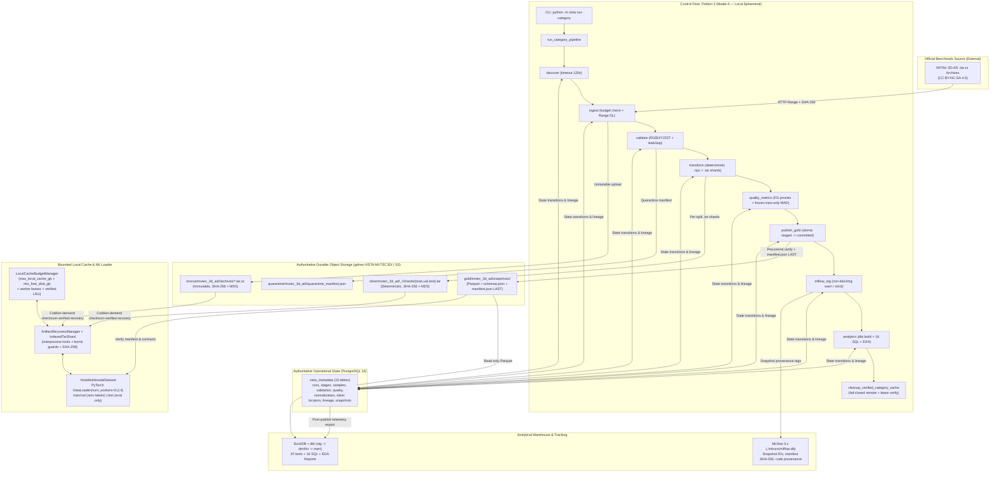

# VISTA — Technology & Architecture Audit

**Audit Reference:** Branch `harden/leakage-snapshots-telemetry-eda` (post-`edda2ce` hardening pass)  
**Guiding Principle:** A smaller, fully integrated, and empirically verified platform is superior to a larger stack with unused dependencies, conflicting sources of truth, or unverified portability claims.

---

## 1. Technology Justification Matrix

| Technology | Actual Responsibility | Real Entry Points | Dependencies | Verification Status | Decision | Engineering Justification |
|---|---|---|---|---|---|---|
| **Python 3.11–3.13** | Core runtime for ingestion, validation, preprocessing, contracts, orchestration, CLI, and tests | `src/vista/__main__.py`, `src/vista/cli.py`, `scripts/run_pipeline.py` | Standard library (`tarfile`, `hashlib`, `msvcrt`/`fcntl`, `dataclasses`, `http.server`) | Executed locally (`3.13.5`) & CI (`3.12`) | **KEEP** | Clean modular monolith; stdlib handles locking, tar security, and config dataclasses without extra frameworks. |
| **NumPy, OpenCV (`opencv-python-headless`), SciPy, `tifffile`, Pillow** | RGB/XYZ/GT decoding, depth & valid-neighbor surface normal math, unsupervised foreground masks, robust MAD/Spearman/KS stats, diagnostic PNG rendering | `src/vista/validation/rules.py`, `src/vista/preprocessing/transforms.py`, `src/vista/quality/{metrics,foreground,normalization}.py`, `src/vista/analytics/visual_diagnostics.py` | `numpy>=1.26`, `opencv-python-headless>=4.10`, `scipy>=1.13`, `tifffile>=2024.5`, `pillow>=10.4` | Unit, E2E, and 1,169 real MVTec 3D-AD samples | **KEEP** | Non-overlapping multimodal vision & scientific computing primitives; headless OpenCV avoids GUI/X11 bloat in CI/WSL2. |
| **PyArrow / Parquet** | Schema-enforced immutable Gold dataset snapshots (`contracts_v1`, `contracts_v2`), ML partition tables, telemetry exports | `src/vista/contracts/schemas.py`, `src/vista/analytics/gold_publisher.py`, `src/vista/contracts/dataset.py` | `pyarrow>=17.0` | Verified across 4 immutable snapshots + schema contract tests | **KEEP** | Strong column typing, columnar compression, zero-copy DuckDB reads, and explicit contract enforcement. |
| **PostgreSQL 16 + SQLAlchemy 2.0 + `psycopg`** | Authoritative operational metadata store (pipeline/stage runs, samples, validation, raw/normalized quality, Silver shard locators, lineage, Gold snapshots) | `compose.yaml` (`vista-postgres`), `src/vista/metadata/{models,database,repository}.py` | `sqlalchemy>=2.0`, `psycopg[binary]>=3.2`, `postgres:16-alpine` | Verified on live `vista-postgres` (1,169 samples) + clean/migration Postgres integration test | **KEEP** | Separates transactional operational state and state-transition integrity from columnar analytical storage; zero large BLOBs stored. Additive idempotent migrations in `database.py` remain reliable without Alembic overhead (see ADR-004). |
| **DuckDB + `dbt-duckdb`** | Reproducible analytical warehouse (`stg_*`, `dim_*`, `fct_*`, `mart_*`), data-quality & leakage tests, 16 analytical SQL queries | `dbt/`, `src/vista/analytics/duckdb_runner.py`, `analytics/sql/*.sql` | `duckdb>=1.1`, `dbt-duckdb>=1.8` | `dbt build` (`PASS=97/97`) + 16 SQL queries + offline E2E fixture test | **KEEP** | Embedded analytical SQL directly over immutable Parquet snapshots with zero extra database server; enforces grain, lineage, and zero-test-leakage tests automatically. |
| **Prefect 3 (Local Ephemeral Execution — Model A)** | Dependent pipeline DAG (`discover → ingest → validate → transform → quality_metrics → publish_gold → mlflow_log → analytics`), task retries, timeouts | `src/vista/orchestration/flows.py` | `prefect>=3.0` | Live 3-category runs + failure-injection/resume reconciliation tests | **KEEP (SIMPLIFY MODEL)** | Retained strictly in **Model A (local ephemeral execution)** with PostgreSQL as the persistent operational state store; no permanent Prefect server daemon is run or required. |
| **MLflow (`mlflow-skinny` 3.18.0)** | Experiment/run provenance linking exact immutable Gold snapshot IDs, manifest SHA-256s, train-manifest hashes, and code provenance | `src/vista/analytics/mlflow_hook.py`, `compose.yaml` (optional `mlflow` profile) | `mlflow-skinny==3.18.0`, `ghcr.io/mlflow/mlflow:v3.18.0` | Unit config/guard tests + live Docker MLflow server create→log→retrieve roundtrip (`test_mlflow_server_live.py`) | **INTEGRATE / SIMPLIFY** | Exact 1:1 client/server version parity (`3.18.0` == `3.18.0`). `VISTA_MLFLOW_MODE` deterministically selects URI with strict compatibility validation; direct local SQLite writes are automatically blocked when the Docker HTTP server is active (`SQLITE_CONCURRENT_WRITER_BLOCKED`). Verified identical `snapshot_id` & `manifest_sha256` across `local` and `server` modes. |
| **Docker Compose** | Local infrastructure for required PostgreSQL 16 (`vista-postgres`) and optional MLflow UI (`--profile mlflow`) | `compose.yaml` | Docker Desktop / Compose v2 | Healthy `vista-postgres` + live `vista-mlflow` (`v3.18.0`) verified and cleanly stopped after test | **KEEP (SIMPLIFIED)** | Removed redundant `vista_mlflow_data` anonymous volume; added MLflow `/health` healthcheck; clearly separates required (`postgres`) from optional (`mlflow` profile). |
| **`rclone` + Google Drive (`gdrive:VISTA MVTEC3D/`)** | Durable cloud object storage for immutable Bronze archives, Silver split `.tar` shards, and Gold snapshots | `src/vista/storage/rclone.py`, `scripts/storage.sh` | WSL2 Ubuntu-24.04 `rclone` (`v1.60.1-DEV`) | Live workspace test, live `cable_gland` recovery test, 3 ingested categories | **KEEP (HARDENED)** | Hardened with typed 8-category error classification (`NOT_FOUND` never conflated with 401/403/429/5xx), bounded retries, timeouts, and unique `.part` staging files. |
| **S3 Portability Abstraction (`StorageBackend` + `RcloneStorageBackend(backend="s3")`)** | Cloud-portable storage contract enabling future migration to AWS S3 | `src/vista/storage/{base,rclone,local}.py`, `docs/storage_s3_migration.md` | `rclone` S3 backend | Verified against ephemeral S3 HTTP REST server (`tests/integration/test_s3_portability.py`); live AWS S3 IAM **NOT VERIFIED** | **KEEP (QUALIFIED)** | Fixed real S3 virtual-directory `stat()` semantic bug and multipart ETag handling; honestly qualified as verified on S3-compatible HTTP REST and configuration-level for live AWS cloud IAM. |
| **`pydantic` & `pydantic-settings`** | Listed previously in `pyproject.toml`, **never imported anywhere in `src/`, `tests/`, or `scripts/`** | None (`src/vista/config.py` uses stdlib `dataclasses` + `PyYAML`) | Previously listed directly | `git grep pydantic` returned 0 matches | **REMOVE** | Removed from direct `pyproject.toml` dependencies (zero dead direct deps; `dataclasses` + explicit validation in `config.py` is simpler and faster). |
| **PyYAML & `httpx`** | Official catalog/config parsing (`configs/vista.yaml`) and resumable HTTP Range downloads/HEAD probes | `src/vista/config.py`, `src/vista/ingestion/{catalog,downloader}.py` | `PyYAML>=6.0`, `httpx>=0.27` | Live `cookie`/`dowel` downloads + catalog unit tests | **KEEP** | Minimal, actively used for configuration and resumable Range HTTP streaming. |
| **`structlog` + PostgreSQL Telemetry + SQL Analytics** | Structured observability across stages, retries, durations, bytes transferred, cache bytes, failure categories, and DQ summaries | `src/vista/logging.py`, `src/vista/orchestration/flows.py`, `analytics/sql/07_pipeline_performance.sql` | `structlog>=24.4` | Audited zero telemetry inconsistencies (`audit_telemetry_consistency() == []`) | **KEEP (NO GRAFANA/PROMETHEUS)** | Meets all operational observability needs cleanly without adding Prometheus/Grafana infrastructure bloat. |
| **PyTorch-compatible Data Access (`VistaMultimodalDataset`)** | Zero-leakage, checksum-verified multimodal dataset loader with cold-cache recovery, disk budgets, and multi-worker `DataLoader` support | `src/vista/contracts/dataset.py`, `src/vista/storage/{recovery,budget}.py` | Optional extra `ml = ["torch>=2.4"]` | Verified with CPU PyTorch `2.15.0+cpu` `DataLoader(num_workers=0, 2, 4)` & `ProcessPoolExecutor(4)` | **INTEGRATE (OPTIONAL EXTRA)** | `torch` kept optional in `pyproject.toml` so DE-only installs remain lean; multi-worker determinism and cold-cache recovery verified empirically. |
| **GitHub Actions CI (4 Mandatory Tiers)** | Automated static lint, secret/binary repo hygiene, core offline suite, live PostgreSQL 16 container, real `rclone` S3-compatible suite, and CPU PyTorch multiworker `DataLoader` suite | `.github/workflows/ci.yml`, `constraints/{base,ml-cpu}.txt`, `scripts/check_repo_hygiene.py` | `ruff==0.17.6`, `pytest==9.2.0`, `postgres:16-alpine`, `rclone`, `torch==2.15.0+cpu` | All 4 CI tiers (`core`, `postgres`, `storage-s3-compat`, `ml-loader`) mandatory with **0 silent skips** (`VISTA_REQUIRE_*=1`) | **KEEP (HARDENED)** | Eliminated silent CI skips by running PostgreSQL, `rclone` S3-compatible, and CPU PyTorch `DataLoader` as explicit mandatory jobs installed from cross-platform constraints. |
| **Spark, Kafka, Kubernetes, MinIO, Redis, Grafana, Alembic** | Not required for current bounded category-by-category single-node workload | None | None | N/A | **DEFER / DO NOT ADD** | Explicitly avoided to preserve a small, coherent, maintainable architecture. |

---

## 2. Verified Architecture & Data/Control Flow Diagram

---

## 3. Failure Recovery Boundaries

1. **Network / API transient failure (`429`, `5xx`, `Timeout`):** Bounded exponential backoff in `RcloneStorageBackend._run_rclone`; permanent errors (`401`, `403`, `CONFIGURATION_ERROR`) fail fast without silent `NOT_FOUND` masking.
2. **Interrupted Bronze download:** HTTP Range resume + `.part` atomic rename + SHA-256 check (`downloader.py`).
3. **Interrupted Silver transform:** Per-sample SHA-256 checkpoint resume skips intact bundles; deterministic `.npz` and `.tar` packing guarantees byte-identical recovery.
4. **Interrupted Gold publication:** Staged under `_staging/`; remote `manifest.json` uploaded **last** only after `_verify_remote_staged_artifacts` passes on every staged artifact. Incomplete runs never expose a `COMMITTED` snapshot.
5. **MLflow or Analytics outage after Gold commit:** `publish_gold` is already committed and immutable; `mlflow_log` follows explicit `warn`/`strict` policy; failed `analytics` marks `pipeline_runs.status = FAILED` while keeping the committed Gold snapshot intact.
6. **Complete local cache loss/cleanup:** `VistaMultimodalDataset` transparently recovers RGB, optional test GT masks, and Silver `.npz` bundles from durable Bronze archives and Silver `.tar` shards with process-safe locks and SHA-256 verification.
